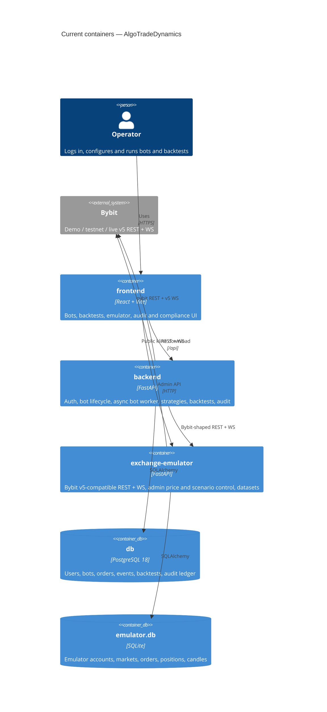

# Architecture map — AlgoTradeDynamics

> The **current** architecture (what exists today), produced by `survey` and read by
> specify / design / data-model / implement. Refresh with `survey` when the repo drifts past
> `reflects_commit`. This is generated; a hand-maintained `docs/architecture.md`, if present, is
> authoritative and reconciled below — not replaced.

## Stack

- Language / runtime: Python 3 for the backend and the emulator (`BE/requirements.txt`, `EXCHANGE_EMULATOR/requirements.txt`); JavaScript on Node >=22.12 for the frontend (`FE/package.json`).
- Frameworks: FastAPI + Uvicorn, SQLAlchemy 2, Alembic, pydantic 2, PyJWT, `pybit` 5.17 (Bybit SDK), `websockets` (`BE/requirements.txt`). React 19, react-router 7, Recharts 3, Framer Motion, Lucide icons, Vite 8 (`FE/package.json`).
- Build / test / lint:
  - Build/run: `docker compose up --build` (`docker-compose.yml`, `README.md` §Запуск). There is no Makefile and no CI config.
  - Backend tests: `pytest` in `BE/tests/` (`BE/requirements.txt:10`). `BE/tests/conftest.py:9-15` forces an SQLite DB and disables the bot worker and rate limiting.
  - Emulator tests: `pytest` in `EXCHANGE_EMULATOR/tests/test_emulator.py`.
  - Frontend: `npm test` (Jest, `FE/jest.config.cjs`) and `npm run lint` (ESLint, `FE/eslint.config.js`) (`FE/package.json:9-17`).
  - No Python linter is configured.

## C4 — system as it is

## Module inventory

| Module | Path | Layers | Wired at | Responsibility |
|---|---|---|---|---|
| API routers | `BE/app/api/` | http | `BE/app/main.py:75-85` | REST + WS endpoints under `/api` (bots, backtests, auth, audit, compliance, privacy, operations, notifications, bybit test, websockets) |
| Services | `BE/app/services/` | app | called from routers | Bot CRUD/lifecycle (`trading_bot_service.py`), backtests (`backtest_service.py`, `backtest_emulator.py`, fast engines), audit, operations, Telegram, UI stream |
| Bot engine | `BE/app/bot_engine/` | domain + infra | `BE/app/main.py:40-42` (lifespan → `start_bot_worker`) | Async worker loop (`runtime.py:18`), per-bot locks (`runtime.py:65`), exchange WS supervisor (`exchange_streams.py:262`), order helpers (`orders.py`), error classification (`error_handling.py`) |
| Strategies | `BE/app/bot_engine/strategies/` | domain | `registry.py:10-14` | `BotStrategy` Protocol (`base.py:9-20`) + Grid, DCA, Momentum, Pattern Scalper; Grid/DCA runtime in `grid_runtime.py` / `dca_runtime.py` |
| Exchange client | `BE/app/bot_engine/bybit/` | infra | `client.py:34` `get_bybit_session(bot)` | Picks `EmulatorHTTP` when `environment == "emulator"`, otherwise a `pybit` session with env-var keys |
| Models / DB | `BE/app/models/`, `BE/app/db/` | infra | `BE/alembic/versions/` | ORM tables: users, trading_bots, trading_bot_orders, trading_bot_events, backtests, audit_events, operations, telegram, refresh_tokens |
| Core | `BE/app/core/` | cross-cutting | `BE/app/main.py:64-67` | Config, logging, auth, rate limit, audit/operations middleware |
| Exchange emulator | `EXCHANGE_EMULATOR/app/` | single service | `main.py` | Bybit v5 endpoints (`main.py:1358-1635`), WS (`main.py:556,570`), admin API (`main.py:581-806`), matching engine (`engine.py`) |
| Frontend | `FE/src/` | ui | `FE/src/pages/*` | Pages, shared UI, API clients (`FE/src/api/`), contexts (`FE/src/context/`), WS client |

## Conventions (cited — the rules a new feature must match)

- **Module wiring / registration:** FastAPI routers are mounted with `prefix="/api"`, and the bot worker starts in the lifespan hook (`BE/app/main.py:40-85`). Strategies are registered as singletons in a dict (`BE/app/bot_engine/strategies/registry.py:10-14`).
- **Exchange access:** every strategy/runtime obtains a session through `get_bybit_session(bot)` (`BE/app/bot_engine/bybit/client.py:34`), which is called directly at about 22 sites across `grid_runtime.py`, `dca_runtime.py`, `momentum.py`, `pattern_scalper.py` and `performance.py`. There is **no exchange interface**: callers use Bybit v5 method names and Bybit response shapes (`lotSizeFilter`, `priceFilter`, `tradeMode`).
- **Credentials:** read from env vars `BYBIT_{DEMO|TESTNET|LIVE}_API_KEY/SECRET` (`BE/app/bot_engine/bybit/client.py:17-26`). Emulator bots use a per-bot `emulator_api_key` instead.
- **Price / qty rounding:** `get_instrument_rules` reads `qtyStep`/`tickSize` from instruments-info, and `round_to_step` + `normalize_order_request` apply them (`BE/app/bot_engine/orders.py:53-85`). The rounding is Bybit-shaped.
- **Client order IDs:** prefix `bot-{id}-g{generation}-` (`BE/app/bot_engine/grid_runtime.py:41-47`) plus a deterministic suffix, e.g. `dca-entry-{level}-{cycle_id}` (`BE/app/bot_engine/dca_runtime.py:213`). The runtime checks for an existing active order with the same link id before placing (`dca_runtime.py:242`), and cancel-by-link-id exists (`orders.py:206`). The generation counter lives on the bot (`BE/app/models/trading_bot.py:51`, migration `0007_add_order_link_generation.py`).
- **Error handling:** errors are classified into type / severity / action (`BE/app/bot_engine/error_handling.py:26-52`), and Bybit codes are mapped at `error_handling.py:79-82`. The available actions are `retry_backoff`, `resync_and_retry`, `pause` and `stop`.
- **Runtime model:** WS events wake the worker, and REST remains the source of truth with a fallback reconciliation (`BE/app/bot_engine/exchange_streams.py:10`, `reconcile_if_due` at `:309`; `WORKER_FALLBACK_SECONDS = 15` at `BE/app/bot_engine/runtime.py:15`).
- **IDs:** integer autoincrement PKs. Orders keep both `order_link_id` and `exchange_order_id` (`BE/app/models/trading_bot_order.py:36-41`).
- **Persistence / DB access:** SQLAlchemy sessions are passed as `db` into engine functions (e.g. `tick_bot_once`, `BE/app/bot_engine/runtime.py`).
- **Migrations:** Alembic, `NNNN_snake_description.py`, 0001–0014 (`BE/alembic/versions/0014_add_compliance_operations_privacy.py`). They are auto-applied on backend start (`README.md` §Важливо при оновленні).
- **Tests:** pytest with an SQLite override and an `auth_headers` fixture (`BE/tests/conftest.py:9-15`). Strategy tests are per strategy (e.g. `BE/tests/test_dca_strategy.py`). The emulator is used as the exchange double; there are no SDK mocks.
- **Inter-module communication:** direct Python calls inside the backend. HTTP + WS between backend and emulator/Bybit, and REST + WS between frontend and backend (`BE/app/api/websockets.py`).
- **UI / styling:** CSS Modules per page/component + global tokens in `FE/src/styles/variables.css` (e.g. `FE/src/pages/BotsPage/BotsPage.module.css`). Details are in §Frontend.

## Datastores

| Store | Engine | Accessed via | Notes |
|---|---|---|---|
| `db` | PostgreSQL 18 (`docker-compose.yml`) | SQLAlchemy + Alembic | All backend state, including the append-only `audit_events` ledger |
| `emulator.db` | SQLite (`/data/emulator.db`, `docker-compose.yml`) | SQLAlchemy (`EXCHANGE_EMULATOR/app/database.py`) | Emulator accounts, markets, orders, positions, candles, datasets |
| test DB | SQLite file | `BE/tests/conftest.py:13` | Test-only override |

## Frontend / UI foundation

- **Component library / design system:** in-repo only; there is no third-party kit. The primitives are in `FE/src/components/ui/` (`Button`, `Card`, `ConfirmModal`, `ConnectionStatus`), and the trading-specific `FE/src/components/trading/TradingBadges`.
- **Design tokens:** CSS custom properties in `FE/src/styles/variables.css` cover the palette (navy bg, emerald accent, coral danger), spacing, radii, shadows, typography (Manrope / JetBrains Mono) and motion. Globals are in `FE/src/styles/globals.css`.
- **Styling approach:** CSS Modules (`*.module.css`) co-located with each component/page, e.g. `FE/src/components/ui/Button/Button.jsx`.
- **Shared primitives:** Button, Card, ConfirmModal (via `FE/src/context/ConfirmModalContext.jsx`), ConnectionStatus.
- **State / data-fetching:** React Context (`AuthContext`, `LanguageContext`, `ConfirmModalContext` in `FE/src/context/`) plus fetch wrappers in `FE/src/api/` (`client.js`, `bots.js`, …). There is no global store or server-cache library.
- **Closest UI precedent:** the bot create/edit form in `FE/src/pages/BotsPage/BotsPage.jsx`. Its defaults are at `:31-32` (`exchange: "bybit"`, `environment: "emulator"`), and the select options are at `:164-165` (`exchange: [{ value: "bybit", label: "Bybit-compatible" }]`, environments emulator/demo/testnet/live). This is where exchange choice for Binance is added.

## Where things live / closest precedents

- A new exchange client → `BE/app/bot_engine/<exchange>/`, modelled on `BE/app/bot_engine/bybit/client.py:34`. Today routing keys on `bot.environment` only, not on `bot.exchange` (`BE/app/models/trading_bot.py:28`).
- A new strategy runtime behaviour → modelled on `BE/app/bot_engine/dca_runtime.py` (the smallest runtime, with link-id dedupe at `:242`).
- A new emulator endpoint / exchange dialect → `EXCHANGE_EMULATOR/app/main.py` routes (`:1358-1635`) + `engine.py` matching.
- A new bot setting / exchange option in the UI → `FE/src/pages/BotsPage/BotsPage.jsx` select options (`:164`), composed from `FE/src/components/ui/*` and the tokens in `variables.css`.
- A schema change → a new `BE/alembic/versions/0015_*.py`.

## Constraints & known tech-debt

- **No exchange abstraction.** About 22 direct `get_bybit_session` call sites across strategies and runtimes, plus Bybit-shaped field names (`lotSizeFilter`, `tradeMode`, Bybit error codes at `error_handling.py:79-82`). Adding Binance means either introducing an exchange port/adapter or translating Binance into Bybit shapes. This is the main design decision for the integration.
- **The emulator speaks only the Bybit v5 dialect** (`EXCHANGE_EMULATOR/app/main.py:1358-1635`, WS at `:556,570`).
- **The emulator has no fault injection.** Its admin API controls accounts, prices, scenarios and datasets (`main.py:581-806`), but cannot drop responses, inject rate-limit errors or force timeouts.
- **The emulator has no partial fills.** Orders go straight to `Filled` (`EXCHANGE_EMULATOR/app/engine.py:615`), even though `PartiallyFilled` is listed as an active status (`engine.py:17`). `README.md` §Поточні обмеження confirms that partial fills and funding are not modelled.
- **Position mode and margin mode are not managed.** No `positionIdx` / mode-switch calls were found. Margin mode is only read for display (`grid_runtime.py:658`).
- **Credentials are server-wide env vars per environment**, not per user (`client.py:17-26`, `README.md` §Поточні обмеження).
- **Recovery policy can auto-resync.** `resync_and_retry` (`error_handling.py:50`) syncs and retries on inconsistent order state, which differs from the brief's "pause on unexplained divergence" rule for Binance.
- **The backtest task runs inside the backend process.** A backend restart interrupts it (`README.md` §Поточні обмеження).
- **The platform is multi-user.** Auth, per-user data isolation, refresh tokens and the audit ledger already exist (migrations 0002, 0010, 0013). New exchange features must respect user scoping even though the brief targets a single operator.

## Reconciliation with the authored architecture doc

No authored architecture doc (`docs/architecture.md`, `ARCHITECTURE.md`, root `CLAUDE.md`, ADRs) exists. `README.md` serves as the de facto description and mostly agrees with the code: services, the event-driven WS + REST reconciliation runtime, the recovery policy and the four strategies. Points of drift and nuance:

- README says the runtime uses "the same event-driven model for Emulator and Bybit". This holds at the protocol level, but the clients differ (`EmulatorHTTP` with an `X-API-Key` header vs the `pybit` SDK).
- README lists partial fills as a future stage. The code agrees: the emulator never partially fills.
- `docs/idea-brief.md` §3/§5 assume no per-user isolation. The platform already has it. That is not a conflict, since a single operator can still use one login, but downstream specs must keep bots user-scoped.
