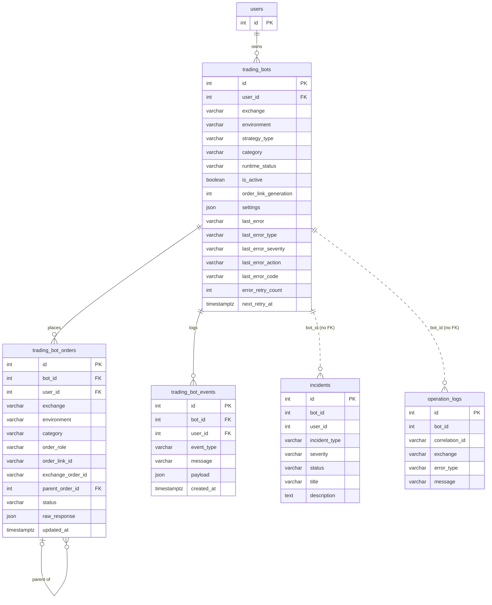

# Data model — exchange-adapter

> **No schema change.** This feature moves exchange access behind an adapter and keeps the stored
> vocabulary frozen ([ADR-0003](adr/0003-keep-stored-order-and-error-vocabulary-as-platform-vocabulary.md)).
> Every entity the flows in `sad.md` §6 persist already exists. This document lists the existing tables
> the feature reads and writes, the values it adds inside existing free-text columns, and why no
> migration is staged. `docs/features/exchange-adapter/migrations/` is intentionally absent.
>
> Convention source: `docs/architecture-map.md` §Conventions (Alembic, `NNNN_snake_description.py`,
> integer autoincrement PKs) and `sad.md` §2, §4 pillar 3, §6 «Data-model hints», §7 «Rollback».

## ER diagram

Only the tables and columns this feature touches are shown. Columns it does not read or write are
left out.

## Entities

All types are as the ORM and the Alembic history define them today. Postgres 18 in production, SQLite
in tests (`BE/tests/conftest.py`). Nothing below is changed by this feature, and every value the
feature writes fits the existing columns.

### Aggregate: `trading_bots` (root)

**Aggregate root:** root. Owns `trading_bot_orders` and `trading_bot_events` (FK, `ON DELETE CASCADE`).
`incidents` and `operation_logs` carry `bot_id` as a plain integer (no FK) and are operational records
outside the aggregate.

#### `trading_bots` — read by the guard, written on pause and start

| Column | Type | Constraints | How this feature uses it |
|---|---|---|---|
| `id` | INTEGER | PK, autoincrement | — |
| `user_id` | INTEGER | NOT NULL, FK → `users(id)` CASCADE, indexed | Ownership check runs **before** venue routing (AC-11, `sad.md` §8) |
| `exchange` | VARCHAR(40) | NOT NULL, default `bybit` | Venue = (`exchange`, `environment`). Read by `exchange_for(bot, needs)` (ADR-0004). No default adapter |
| `environment` | VARCHAR(20) | NOT NULL, default `demo` | Second half of the venue key |
| `strategy_type` | VARCHAR(40) | NOT NULL | Picks the strategy's `required_capabilities(bot)` (ADR-0006) |
| `category` | VARCHAR(20) | NOT NULL, default `linear` | Market type for the capability check (spot / linear / inverse) |
| `runtime_status`, `is_active` | VARCHAR(20), BOOLEAN | NOT NULL | Guard pause writes the paused state exactly as an error pause does today (Flow 7) |
| `order_link_generation` | INTEGER | NOT NULL | Part of the frozen client-tag format `bot-{id}-g{gen}-…` (ADR-0003) |
| `settings` | JSON | NOT NULL | Read for capability needs (e.g. Momentum `position_side`) |
| `last_error` | VARCHAR(500) | NULL | Scrubbed message only (AC-16, ADR-0008). A guard pause reason (venue or capability + market type) fits in 500 |
| `last_error_type` | VARCHAR(40) | NULL | **Stored values unchanged** (`network`, `rate_limit`, `order_state`…). New error class `unknown_order` stores `order_state` (ADR-0005) |
| `last_error_severity`, `last_error_action` | VARCHAR(20), VARCHAR(40) | NULL | Same values as today, from the engine's class table |
| `last_error_code` | VARCHAR(40) | NULL | Raw exchange code, kept for diagnosis (AC-06) |
| `error_retry_count`, `next_retry_at` | INTEGER, TIMESTAMPTZ | NOT NULL / NULL | Back-off and the AC-08 lookup retry share the existing `error_max_retries` budget |

<!-- TBD: does a guard pause (venue unsupported / capability missing) also write `last_error_type` /
`last_error_action`, or only the event and incident? Any value ≤ 40 chars fits; it is a `tasks`-level
choice, not a schema one. -->

#### `trading_bot_orders` — read natively across a deploy, status updated by bot + client tag

| Column | Type | Constraints | How this feature uses it |
|---|---|---|---|
| `id` | INTEGER | PK, autoincrement | — |
| `bot_id` | INTEGER | NOT NULL, FK → `trading_bots(id)` CASCADE, indexed | Flow 3 / Flow 5 lookups |
| `user_id` | INTEGER | NOT NULL, FK → `users(id)` CASCADE, indexed | — |
| `exchange`, `environment`, `category` | VARCHAR(40/20/20) | NOT NULL | Written as today from the bot |
| `order_link_id` | VARCHAR(160) | NULL, indexed | Client tag. Format frozen (ADR-0003). Binance's 36-char limit is a declared capability, not a column change (spec §8 OQ) |
| `exchange_order_id` | VARCHAR(120) | NULL | As today |
| `status` | VARCHAR(30) | NOT NULL, default `New` | **Frozen stored vocabulary** (`New`, `PartiallyFilled`, `Filled`, `Cancelled`, `Rejected`, `Deactivated`, `Untriggered`…). Any adapter maps into it. AC-08: the status changes only on `unknown_order`, `not_found` or a `final` lookup answer |
| `raw_response` | JSON | NOT NULL | Stays a raw exchange payload. Readers of Bybit keys (`reduceOnly`, `momentum.py:632,926`) move to a neutral accessor with a legacy-key fallback (`sad.md` §11). The reduce-only flag rides in this JSON. **No new column** |
| `parent_order_id` | INTEGER | NULL, FK → `trading_bot_orders(id)` SET NULL | As today |

#### `trading_bot_events` — event feed (Flows 1, 2, 4, 5, 7, 9)

| Column | Type | Constraints | How this feature uses it |
|---|---|---|---|
| `id` | INTEGER | PK | — |
| `bot_id`, `user_id` | INTEGER | NOT NULL, FK CASCADE, indexed | — |
| `event_type` | VARCHAR(40) | NOT NULL | Today's event types. The only new categories are the guard pause reasons (`sad.md` §8 «Events»), which never fire for a Bybit bot that runs today |
| `message` | VARCHAR(500) | NOT NULL | Scrubbed text only (AC-16). Rows stored before the deploy are not rewritten |
| `payload` | JSON | NULL | Keeps the stored error type + raw exchange code (AC-06), scrubbed |

### Operational records (outside the bot aggregate)

#### `incidents` — guard pauses and error pauses

| Column | Type | Constraints | How this feature uses it |
|---|---|---|---|
| `incident_type` | VARCHAR(80) | NOT NULL, indexed | Two new **values**, no schema change: `venue_unsupported` and `capability_missing` (`sad.md` §6, §7). `create_bot_incident` stores `incident_type.upper()[:80]` (`BE/app/services/operations_service.py:104`), so they persist as `VENUE_UNSUPPORTED` / `CAPABILITY_MISSING` |
| `title`, `description` | VARCHAR(255), TEXT | NOT NULL / NULL | Scrubbed at the sink (ADR-0008) |
| `bot_id`, `user_id` | INTEGER | NULL, indexed, no FK | As today |

#### `operation_logs` — operation log entries (Flows 4, 9)

| Column | Type | Constraints | How this feature uses it |
|---|---|---|---|
| `exchange` | VARCHAR(40) | NULL, indexed | As today |
| `error_type` | VARCHAR(80) | NULL, indexed | Same stored error type as `trading_bots.last_error_type` |
| `correlation_id` | VARCHAR(180) | NULL, indexed | `bot:{id}`, as today |
| `message` | VARCHAR(1000) | NOT NULL | Scrubbed (AC-16) |

## Indexes

**No new index.** Every query in the `sad.md` §6 flows is an existing query and is already served.

| Index (existing) | Columns | Query it serves |
|---|---|---|
| `ix_trading_bots_user_id` (0003) | `trading_bots(user_id)` | Flows 2, 6: load the bot owned by the Operator (ownership before routing, AC-11) |
| `ix_trading_bot_orders_bot_id` (0004) | `trading_bot_orders(bot_id)` | Flow 3: read own order rows. Also the FK index |
| `ix_trading_bot_orders_order_link_id` (0005) | `trading_bot_orders(order_link_id)` | Flows 3, 5: `bot_id = ? AND order_link_id = ?` status update by bot + client tag (`grid_runtime.py:204,910`). The tag embeds the bot id, so this single-column index is already selective |
| `ix_trading_bot_events_bot_id` (0005) | `trading_bot_events(bot_id)` | Event feed per bot. Also the FK index |
| `ix_incidents_incident_type` (0014) | `incidents(incident_type)` | Filtering guard-pause incidents apart from exchange errors (`sad.md` §7 Monitoring) |

Considered and discarded: a composite `(bot_id, order_link_id)` index. The query already exists, the
feature does not change how often it runs, and the existing single-column index on the tag is
selective. It would cost writes with no measured gain.

Not indexed by design: the worker's «load running bots» query (`runtime.py:53`) is unchanged by this
feature, so it is out of scope here.

## Test fixtures

No new fixtures. The golden-run harness (ADR-0007, `BE/tests/golden/`) snapshots mid-cycle states as
the emulator SQLite file plus the existing `trading_bots` / `trading_bot_orders` rows. Those snapshots
are recorded from the pre-refactor code, not built by factories. Fixture users follow the existing
`BE/tests/conftest.py` pattern (`example.test` addresses only, no real-looking PII).

## Why no migration (checked)

- **New entity?** No. `sad.md` §6 «Data-model hints»: bot order rows, bot state, bot events, bot
  incidents and the operation log all exist.
- **New column?** No. Venue = existing (`exchange`, `environment`). Capabilities are declared in code
  (ADR-0006). The reduce-only flag stays in `raw_response` JSON. Error classes are not stored: they map
  onto the existing stored error type (ADR-0005).
- **Changed values in existing rows?** No. ADR-0003 rejects a data migration because migrations auto-apply
  on backend start while bots are mid-cycle (`README.md`).
- **Column too short for a new value?** No. `incident_type` ≤ 80 (`CAPABILITY_MISSING` = 18),
  `last_error_type` ≤ 40 (values unchanged), `message` / `last_error` ≤ 500 (scrubbed pause reason).
- **Rollback.** Redeploying the previous image is safe because nothing in the schema changes (`sad.md` §7).
