# Software Architecture Document — exchange-adapter

<!-- 12 Arc42 sections. Empty section → <!-- N/A: <one-line reason> -->. -->
<!-- C4 Context (L1) lives inline in §3. C4 Container (L2) lives inline in §5. -->
<!-- Numbers in §10 come VERBATIM from spec.md §6 NFR — no inventing, no rounding. -->

## 1. Introduction and goals

<!-- 🎯 Why: durable memory of «what + the three dominant qualities + who cares». A year from
     now nobody recalls which three qualities were critical for this system.
     📋 Write: 1 ¶ intent + 3 lines of top-3 quality goals + a stakeholders table.
     ¶4 is the override slot — critic `Override` resolutions emit «Decision override: <headline>
     — rationale: <reason>» bullets here so downstream skills see the deliberate choice. -->

**Intent.** Every Grid, DCA, Momentum and Pattern Scalper bot reaches an exchange only through one exchange-neutral **exchange adapter**, chosen by the bot's **venue**. The same goes for its runtime, the live exchange event streams, the error handling and the connection check. The adapter takes requests and returns results in platform terms, reports failures as **error classes**, and declares its **capabilities** per market type. Bybit (emulator, demo, testnet, live) moves behind it with **trading equivalence**, including bots that are mid-cycle when a migration step is deployed. An unsupported venue or a missing capability fails closed. The Operator keeps trusting their Bybit bots, and Binance (roadmap step 1) becomes "add an adapter" instead of "fork the strategies".

**Top-3 quality goals (1-liners; full scenarios in §10):**

1. **Trading equivalence across every migration step.** The same orders, bot state and error reactions as before the refactor, including mid-cycle bots across a deploy (no second ladder, no re-placed take-profit).
2. **Fail-closed safety.** No order ever reaches an exchange the bot's venue did not choose, no strategy relies on a capability its adapter did not declare, and no key or secret leaks through the adapter's error paths.
3. **Exchange extensibility.** 0 places outside exchange adapters reach an exchange, so adding an exchange changes 0 strategy files.

When goals conflict, the higher one wins (for example, keeping today's stored values beats a "purer" neutral vocabulary). Reaction latency and adapter overhead are guard-rails, not top-3 goals; their scenario is QG-4 in §10.

**Stakeholders.**

| Role | Interest | Sign-off owner? |
|---|---|---|
| Operator | Runs Bybit bots of all four strategies. Needs trading equivalence across deploys, fail-closed refusals and pauses with a stated reason, and no key leaks | No |
| Tech Lead | SAD and ADR approval, and ownership of the golden-run and failure-table gate before every merge | Yes |
| Security Lead | Exchange credentials and error payloads move into a new component (spec §6.1 «Security review: Required») | Yes |

<!-- Decision overrides (¶4) — populated by the critic resolution loop, empty otherwise. -->

## 2. Constraints

<!-- 🎯 Why: §4 strategy only works when §2 has fixed WHAT IS ALREADY FIXED — stack, versions,
     deadline, regulatory. This is an input, not an output.
     📋 Write: four blocks — Technical / Organisational / Conventions / Regulatory.
     📌 Pin versions («<datastore> 18», not «<datastore>»); «Q3 deadline — hard», not «ideally».
     Never N/A — every feature inherits at least Conventions + Technical. -->

**Technical.**
- Python 3.14 for the backend and the exchange emulator (`BE/Dockerfile`, `EXCHANGE_EMULATOR/Dockerfile`: `python:3.14-slim`).
- FastAPI 0.141.1, Uvicorn 0.52.4, SQLAlchemy 2.0.52, Alembic 1.19.1, pydantic 2.13.4, PyJWT 2.13.0, pybit 5.17.0 (Bybit SDK), websockets 17.0.1, httpx2 2.12.0 (`BE/requirements.txt`).
- PostgreSQL 18 for all backend state (`docker-compose.yml`). SQLite for `emulator.db` and for the backend test database (`BE/tests/conftest.py:9-15`).
- The bot worker is an in-process asyncio loop started in the FastAPI lifespan (`BE/app/main.py:40-42`, `BE/app/bot_engine/runtime.py`). Strategies are synchronous calls that receive a SQLAlchemy session and the bot. WS events wake the worker, REST stays the source of truth, and there is a 15 s fallback reconciliation (`runtime.py:15`).
- The exchange emulator speaks only the Bybit v5 dialect. It has no fault injection and no partial fills (`EXCHANGE_EMULATOR/app/engine.py:615`), so error-reaction equivalence is proven with the reference failure table (spec AC-06), not with emulator faults.

**Organisational.**
- Team: one developer (Oleh Solomko) acting as Tech Lead. A Security Lead review is required (spec §6.1).
- Budget: size M, about 1–2 sprints. No hard deadline. This is wave 1 of `docs/roadmap.md`, and it blocks step 1 (Connect Binance).
- There is no CI pipeline in the repo. The spec §6 checks (golden runs, failure table, static search, existing suites) run as a local pre-merge routine, `scripts/premerge.sh` (spec §8, resolved; see test-plan.md «CI placement»).
- Delivery is a sequence of migration PRs. Each one must pass the golden runs, the failure table and 100% of the existing backend and emulator suites before it merges. This release builds and gates the steps one by one on one branch and deploys them once onto the pre-refactor version (§7 «Release (2026-10-18)»).

**Conventions.**
- [`docs/architecture-map.md`](../../architecture-map.md) §Conventions is the convention source. Exchange clients live in `BE/app/bot_engine/<exchange>/`. Routers are mounted under `/api`. Strategies are registry singletons. Errors are classified into type, severity and action (`retry_backoff`, `resync_and_retry`, `pause`, `stop`). PKs are integer autoincrement. Alembic files are named `NNNN_snake_description.py`.
- Client order tags are `bot-{id}-g{generation}-…` plus a deterministic suffix (`grid_runtime.py:41-47`, `dca_runtime.py:213`).
- Tests use pytest with an SQLite override and the emulator as the exchange double, with no SDK mocks. In this step only mechanical test edits are allowed (spec §6 «Existing test suites»).

**Regulatory / external.**
- Data classification is confidential: exchange credentials plus the Operator's balances, positions and orders (spec §6.1). No new personal data.
- Keys appear at most masked to their last 4 characters (`****abcd`). Secrets never appear, even in part. Records stored before the deploy are not rewritten (AC-16).
- The platform is multi-user. Bot ownership checks run before any venue routing (AC-11), and the connection check requires a signed-in operator (AC-14).

## 3. Context and scope

<!-- 🎯 Why: draws the SYSTEM BOUNDARY — who talks to it from outside, where the trust zone ends.
     Without §3, §5 and §8 (authorization) blur — unclear what's «inside» vs «outside».
     📋 Write: 2–3 sentences of business context + an external-systems table + a C4Context block.
     📌 «External: none (deliberate, no third-party in v1)» is itself a decision worth stating.
     Trust boundary — the line past which you don't trust data without checking it.
     Never N/A — greenfield still draws the planned actors + external systems. -->

AlgoTradeDynamics lets an Operator configure, run and supervise Grid, DCA, Momentum and Pattern Scalper bots, and run backtests of them. Today it trades only on Bybit (emulator, demo, testnet, live). This feature changes no external relationship: the same Operator talks to the same platform, and the platform talks to the same Bybit environments and the same exchange emulator. What changes is the boundary *inside* the platform. Every exchange request leaves through an exchange adapter chosen by the bot's venue, and the trust boundary around exchange responses (error texts that may echo keys, Bybit-shaped payloads) moves into that adapter.

<!-- brownfield: architecture-map.md reflects fb25db3; no BE/EXCHANGE_EMULATOR/FE change since (HEAD d75458e). direct exchange access in 9 backend files (grid_runtime, dca_runtime, momentum, pattern_scalper, orders, performance, market_data, positions, api/bybit), plus exchange_streams.py and error_handling.py. -->

**External systems (in / out):**

| Actor or system | Type | Interaction |
|---|---|---|
| Operator | Person | Signs in, creates bots, starts, stops, syncs and closes them, reads the bot page and the event feed, runs backtests and runs the connection check (API only in this step) |
| Bybit (demo / testnet / live) | System (external) | v5 REST for orders, order lookups, executions, prices, instrument rules, balances and positions, plus the v5 private and public WS streams. Keys are server-wide per environment |
| Exchange emulator | System (internal, separate deployable) | Bybit v5-compatible REST and WS. The venue «Bybit emulator» trades here with a per-bot or default emulator account key. Backtests also run here |
| Telegram | System (external) | Receives bot notifications (pauses, errors) when the Operator has connected Telegram and allows that event type |
| Binance | System (external) | **Out of scope for this step.** No adapter and no connection. Roadmap step 1 adds it behind the seam this step builds |

**C4 Context (L1):**

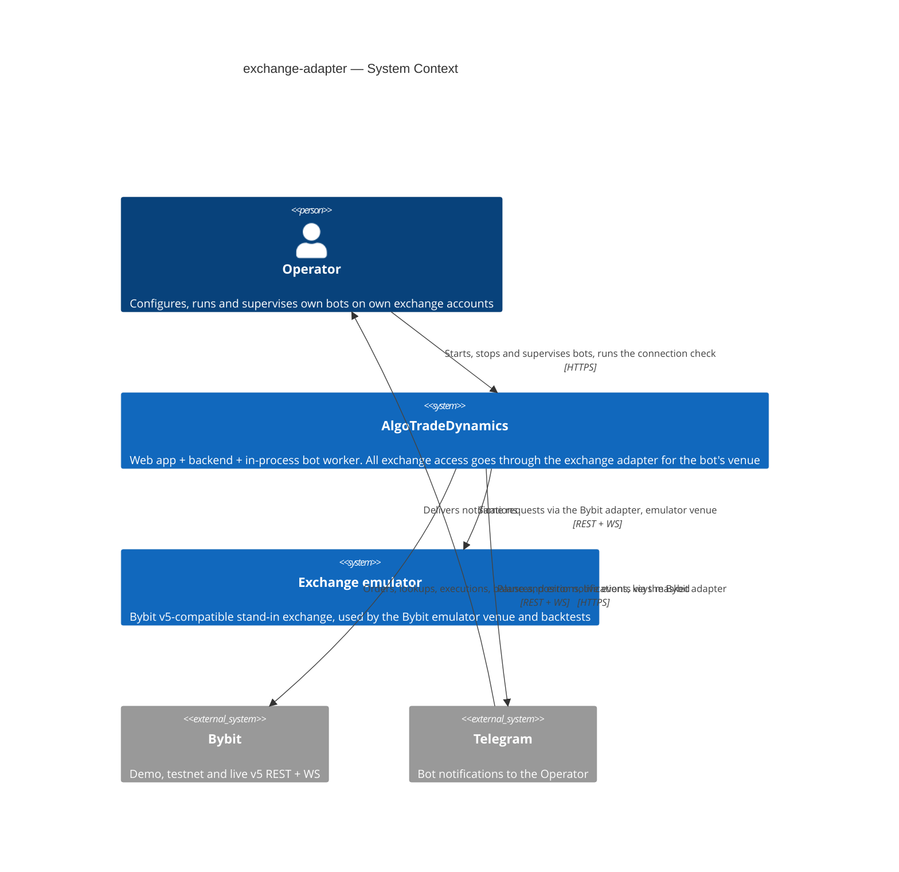

## 4. Solution strategy

<!-- 🎯 Why: the 3–4 STRATEGIC PILLARS every ADR grows from. Without §4 each ADR looks random —
     there's no umbrella. ⭐ The densest section — the blast-radius gate fires almost always here
     (decisions are irreversible + multi-module).
     📋 Write: 3–4 choices; each a heading + 2–3 sentences of rationale.
     📌 «Store content as a table of typed blocks» is a pillar — ADR-0001 grows from it. -->

**Target surface.** `[backend-service]`. The feature changes the backend: the API routers plus the in-process bot worker, strategies and runtimes. `ux-flows.md` shows no new screen and no new navigation. Refusal and pause reasons are backend messages, shown through the existing failed-start message, the bot page's event feed and the existing «Trading bot not found» state. The bot worker runs inside the backend process (FastAPI lifespan), so it is part of the `backend-service` container, not a separate `worker` surface. A single surface does not cross the blast-radius gate, so this is recorded inline. There is no UI-architecture decision (no UI surface).

**Top strategic choices (the seeds for ADRs):**

1. **A typed, exchange-neutral adapter port** ([ADR-0001](adr/0001-define-a-typed-exchange-neutral-adapter-port.md)). Strategies, runtimes, the stream supervisor, performance and the connection check call one `ExchangeAdapter` interface in platform terms: place, cancel and look up orders, open orders, order history, executions, instrument rules, ticker, candles, balance, positions, live event streams and the connection check. They get back neutral types and `ExchangeError` with an error class. No Bybit field name (`lotSizeFilter`, `closedPnl`, `tradeMode`, `retCode`) survives outside the Bybit adapter. This serves QG-3 (0 strategy files change for Binance), and the golden runs guard QG-1 against translation mistakes.
2. **The Bybit adapter wraps today's clients** ([ADR-0002](adr/0002-implement-the-bybit-adapter-over-the-existing-clients.md)). The adapter keeps `pybit` 5.17 for demo, testnet and live, and `EmulatorHTTP` for the emulator, as its transports. It sends the same parameters in the same order as today and only translates responses. Order-mutating requests (place, cancel) stay byte-identical on the wire, so trading equivalence (QG-1) is a property of the design, not of luck, and no new dependency enters the money path. Read requests may change where §8 says so (the by-tag order lookup). Trading equivalence compares orders, state and reactions, not reads.
3. **The persisted vocabulary is frozen and becomes the platform vocabulary** ([ADR-0003](adr/0003-keep-stored-order-and-error-vocabulary-as-platform-vocabulary.md)). This covers stored order statuses (`New`, `PartiallyFilled`, `Filled`, `Cancelled`, `Rejected`, `Deactivated`, `Untriggered`…), stored error types (`network`, `rate_limit`, `order_state`…) and client order tags (`bot-{id}-g{gen}-…`). Rows written by the pre-refactor code are read natively by the migrated code, so a mid-cycle bot recognises its own orders after a deploy (AC-05, QG-1), and stored error types stay the same (AC-06). Any other adapter maps into this vocabulary. No data migration.
4. **Venue resolution fails closed through one guard** ([ADR-0004](adr/0004-resolve-adapters-by-venue-through-a-fail-closed-guard.md)). The venue is derived from the existing `trading_bots.exchange` and `environment` columns. A registry maps each venue to an adapter factory, with no default. One guard, `exchange_for(bot, needs)`, runs at every entry point that can reach an exchange (start, stop, worker tick, live-event wake-up, sync, cancel, close, clear history, position and order reads) **before** any request. It either hands back the adapter or raises «venue has no adapter» or «capability missing», which the caller turns into a refused start or a pause with the reason stated (AC-09, AC-10, AC-15, AC-15b, QG-2). On any other action the refusal is a 422 with the reason and the bot left as it is; the bot page read degrades to the stored figures, and clear history clears locally and skips only the exchange cancel (Flow 2; ADR-0004 amendment).
5. **Error classes are decided in the adapter, reactions in the engine** ([ADR-0005](adr/0005-classify-errors-in-the-adapter-and-react-in-the-engine.md)). The adapter maps exchange codes, HTTP statuses and message texts to an error class and keeps the raw code alongside. The engine keeps one table, error class → (stored error type, severity, action, retry delay), reproducing today's reactions exactly. A new error class, `unknown_order`, is stored as today's type `order_state` and drives the AC-08 lookup rule. Raw codes never drive behaviour outside the adapter (glossary «Error class»).
6. **Capabilities are declared statically per adapter and market type** ([ADR-0006](adr/0006-declare-capabilities-statically-per-market-type.md)). Each adapter declares a constant capability set per market type (`spot`, `linear`, `inverse`). Each strategy computes the capabilities it requires from the bot's settings. The guard compares the two without any network call, so a refusal sends nothing to any exchange (AC-15). The Bybit declaration is derived from what the strategies use today, so no Bybit configuration that starts today is refused (§5 catalogue).
7. **The golden-run harness is the safety net** ([ADR-0007](adr/0007-record-golden-runs-at-the-emulator-client-in-a-pytest-harness.md)). A pytest harness runs the real exchange emulator as a local subprocess on a temporary SQLite file and the backend bot engine and worker in-process on SQLite. It drives prices through the emulator admin API and records every request at the `EmulatorHTTP` client boundary, which exists both before and after the refactor. It snapshots mid-cycle states (the emulator DB file plus the bot and order rows), and it timestamps fill → reaction on the wall clock. It produces the 8 recordings, the 12 replays and the latency and overhead numbers (spec §6).
8. **Secrets are scrubbed twice** ([ADR-0008](adr/0008-scrub-secrets-at-the-adapter-and-at-every-sink.md)). One shared scrubber knows every configured key and secret of every venue, plus the emulator account keys in use. The adapter applies it to every error it raises, and every sink applies it again: bot events, the operations log, incidents, Telegram, the connection-check answer, the clear-history cancel error and a root logging filter. Keys appear at most as `****abcd`, and secrets never appear (AC-16, QG-2).

**Migration order (inline; the spec commits to step by step).** (0) Build the harness, take the 8 recordings, the reference failure table and the latency and overhead baselines on the pre-refactor code. (1) Add the port, the Bybit adapter, the registry, the guard and the scrubber, with the guard wired into start and the worker tick. (2) Move the `orders.py`, `market_data.py` and `positions.py` helpers onto the port. (3) DCA (the smallest runtime). (4) Grid. (5) Momentum. (6) Pattern Scalper. (7) `performance.py`, `exchange_streams.py`, `error_handling.py` and the UI live stream (`api/websockets.py`). (8) The connection check, then delete `get_bybit_session`, with the static search at 0. Every step is its own PR and passes the golden runs, the failure table and the existing suites before it merges. The steps ship together in one deploy (§7 «Release (2026-10-18)»). While the steps are in progress, the guard already protects start and the worker tick from step (1) onward.

Each tactical decision in later sections should trace to one of these seeds. Tactical decisions that *contradict* a strategic choice are red flags — surface them in §11.

## 5. Building block view

<!-- 🎯 Why: INTERNAL DECOMPOSITION — modules, containers, datastores. The static topology: who
     may talk to whom. Without §5, §6 (the flows) has no vocabulary of participants.
     📋 Write: 1 ¶ on the style (layered / hexagonal / clean / event-driven) + a folder tree + a
     C4Container block.
     📌 Draw ONE Container per declared `target_surface` (frontmatter): a fullstack
     [backend-service, web-frontend] = a backend-API container + a web/SPA container; a
     [backend-service, mobile-app] = the API + the mobile app. The Container(web, …) line below is
     just one surface's container — swap/add per what was declared in §4. → _shared/surfaces.md
     📌 e.g. «web app, content API, media worker, datastore, object store, CDN». -->

The backend keeps its current layering (routers → services → bot engine → models; `docs/architecture-map.md` §Module inventory). This feature applies **ports and adapters at the exchange boundary only**. Inside the bot engine, a new `exchange/` package owns the port (ADR-0001), the venue registry and guard (ADR-0004), the error-class and capability vocabularies (ADR-0005, ADR-0006), the scrubber (ADR-0008) and one sub-package per exchange. Strategies, runtimes, performance, the stream supervisor, the services and the connection check depend on `exchange/` and obtain an adapter only from `exchange_for(bot, needs)`. Only `exchange/<name>/` may import an exchange client (`pybit`, `EmulatorHTTP`) or open an exchange WS connection, and that is the rule the spec §6 static search enforces. This is the existing convention «exchange client → `bot_engine/<exchange>/`», gathered under one parent so that the rule is a single path prefix.

**Internal decomposition:**

```
BE/app/bot_engine/
├── exchange/                    NEW — the exchange seam
│   ├── port.py                  ExchangeAdapter Protocol + neutral types: Order, OrderLookup
│   │                            (open | final(filled/cancelled…) | not_found), Execution, Position,
│   │                            Balance, InstrumentRules, Ticker, Candle, StreamEvent, ConnectionStatus
│   ├── errors.py                ErrorClass, ExchangeError(error_class, raw_code, message),
│   │                            VenueNotSupported, CapabilityMissing
│   ├── capabilities.py          Capability enum, CapabilitySet, client_tag_max_length
│   ├── registry.py              venue (exchange, environment) → adapter factory, no default;
│   │                            exchange_for(bot, needs) — the only way to obtain an adapter
│   ├── redaction.py             Scrubber over every configured key/secret + emulator account keys;
│   │                            mask_key() → ****abcd
│   └── bybit/                   Bybit adapter (moved from bot_engine/bybit/)
│       ├── adapter.py           BybitAdapter — pybit / EmulatorHTTP transport, response → neutral types
│       ├── client.py            session factory + get_bybit_credentials (moved, private to the package)
│       ├── emulator_client.py   EmulatorHTTP (moved)
│       ├── errors.py            Bybit codes / HTTP status / texts → ErrorClass (moved from error_handling.py)
│       ├── streams.py           Bybit + emulator WS endpoints, auth, topic → StreamEvent
│       └── capabilities.py      BYBIT_CAPABILITIES per market type
├── error_handling.py            CHANGED — ErrorClass → (stored type, severity, action, delay); guard-pause path
├── exchange_streams.py          CHANGED — supervisor exchange-neutral, asks the adapter for streams
├── orders.py, positions.py,
│   market_data.py, performance.py   CHANGED — neutral helpers over the port; rounding over InstrumentRules
├── strategies/*.py, grid_runtime.py,
│   dca_runtime.py               CHANGED — required_capabilities(bot); adapter received from the guard
├── runtime.py, bot.py           CHANGED — guard before every tick/start/action
BE/app/api/bybit.py              CHANGED → venue-parameterised connection check through the adapter, auth required
BE/app/api/websockets.py         CHANGED → UI live stream takes its endpoints from the adapter (critic finding)
BE/app/services/backtest_*.py,
  fast_*_backtest.py             CHANGED → instrument rules through the Bybit emulator adapter (ADR-0009)
BE/tests/golden/                 NEW — harness, 8 recordings, reference failure table, latency/overhead baseline
```

**Capability catalogue (ADR-0006; closes spec §8 OQ «which capabilities…»).** These are derived from what each strategy calls today, so no Bybit configuration that starts today is refused (AC-15).

| Capability | Meaning | Required by (today's usage) | Bybit declares on |
|---|---|---|---|
| `limit_orders` | Place limit orders with a client tag | Grid, DCA, Momentum, Pattern Scalper | spot, linear, inverse |
| `market_orders` | Place market orders with a client tag | Grid (close-position and close-on-stop exits), DCA (market entry), Momentum, Pattern Scalper | spot, linear, inverse |
| `reduce_only_orders` | Mark an exit as reduce-only | Grid, DCA (take-profit roles), Momentum, Pattern Scalper | spot, linear, inverse |
| `position_reads` | Report open position size, side, entry, mark, liq price, leverage, margin mode | Grid, DCA (long position for its take-profit, every tick), Momentum, Pattern Scalper | spot, linear, inverse |
| `short_selling` | Open short exposure | Momentum when the market type is not spot **and** `position_side` ∈ {`both`, `short`} (exactly `_short_trading_supported`, `momentum.py:583-585`; a spot Momentum bot with the default `both` never shorts and does not require it), Pattern Scalper | linear, inverse (not spot; Momentum already refuses spot + short at `momentum.py:811`) |
| `execution_pnl` | Executions carry realised PnL and fee per fill | Grid, DCA (performance), Momentum, Pattern Scalper | spot, linear, inverse |
| `wallet_balance` | Read the account's available balance | Momentum, Pattern Scalper (risk guards) | spot, linear, inverse |
| `candles` | Closed candles by interval | Momentum, Pattern Scalper | spot, linear, inverse |
| `order_lookup_by_tag` | Find an order by client tag in open orders and order history | Grid, DCA, Momentum, Pattern Scalper | spot, linear, inverse |
| `private_event_stream` | Live order, execution, position and wallet events | all (worker wake-ups) | spot, linear, inverse |
| `client_tag_max_length` (value) | Longest client tag the exchange accepts | **declared, not enforced by the guard in this step.** Momentum tags today are about 43 characters (`momentum.py:767,1103`), so enforcing would refuse every Momentum bot (AC-15). Enforcement arrives with the step 1 decision on tag shape (spec §8 OQ) | 36 |

The Bybit declaration **mirrors today's behaviour**, including cases that are semantically loose (for example `position_reads` on spot, which Momentum calls today). Tightening is the strategy × market × mode matrix (decision D2, spec §3 non-goal). An invariant test asserts that every configuration accepted by today's `_validate_strategy_configuration` passes the guard.

**Connection check.** The check takes a venue, requires a signed-in operator (AC-14) and stays under the existing per-user rate limit (spec §6.1). It goes through `exchange_for(venue)` and the adapter's `check_connection()`, and answers `connected`, `not_configured` or `failing` + error class, never with a raw exchange message or any key (AC-12, AC-13, AC-13b). It **replaces** today's unauthenticated, demo-only `/api/bybit/test` with a venue-parameterised route under an exchange-neutral name. The exact path and shape are decided by the `api` stage. Nothing in `FE/src` calls the old route (`ux-flows.md` §Platform decisions), so it is removed without a UI change. The existing connection-check test changes, which spec §6 allows for this test only. There is no default venue (ADR-0004).

**C4 Container (L2):**

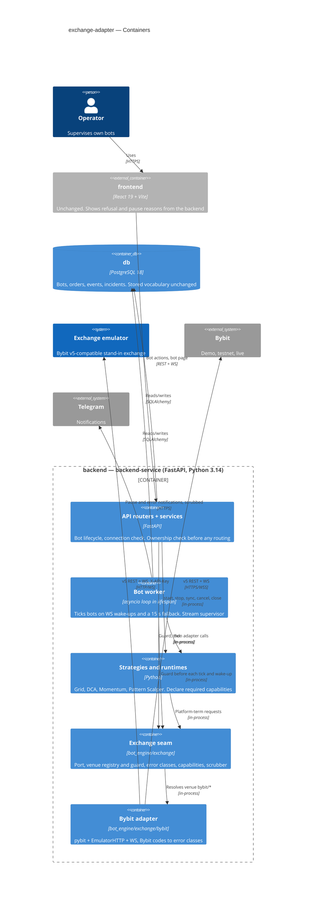

The golden-run harness (`BE/tests/golden/`, ADR-0007) is test-only and not a runtime container. It runs the emulator in a subprocess and the bot engine in-process.

## 6. Runtime view

<!-- 🎯 Why: the RUNTIME FLOW of 1–2 critical scenarios — who talks to whom, when, in what order.
     Without §6, §5 is just boxes with no life.
     📋 Write: a Mermaid sequenceDiagram. Participants are names from §5 (don't invent new ones).
     Messages are semantic («saves a draft»), NO HTTP verbs / paths / status codes — endpoint-level
     sequences arrive at the `api` stage.
     📌 e.g. «author → web: composes draft → web → content API: save». Seed the primary flow(s) here;
     the `sequences` stage then covers every §5 AC (no cap). Never N/A for M+; XS/S keeps ≥1 happy-path flow. -->

These are seed flows that use the §5 container names. The `sequences` stage adds a flow or branch for every spec §5 AC: the mid-cycle recognition after a deploy (AC-04, AC-05), the order-lookup rule (AC-08), cross-user refusal (AC-11), the connection check (AC-12, AC-13, AC-13b, AC-14) and scrubbing (AC-16).

**Critical flow 1: a live event wakes a bot, which trades through its venue's adapter (US-01, US-03, US-04, US-06)**

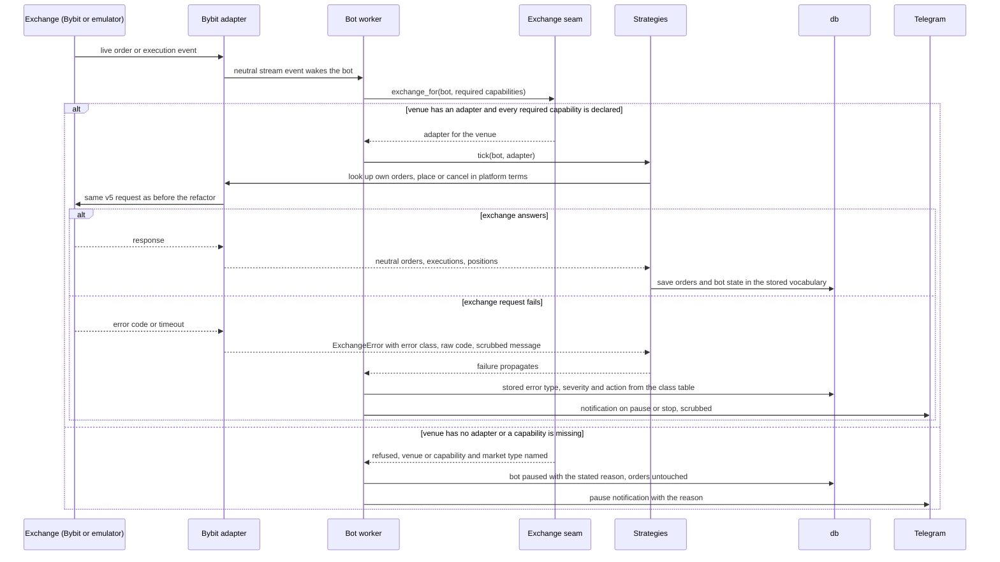

**Critical flow 2: Operator starts a bot and the start is checked before anything reaches an exchange (US-04, US-06)**

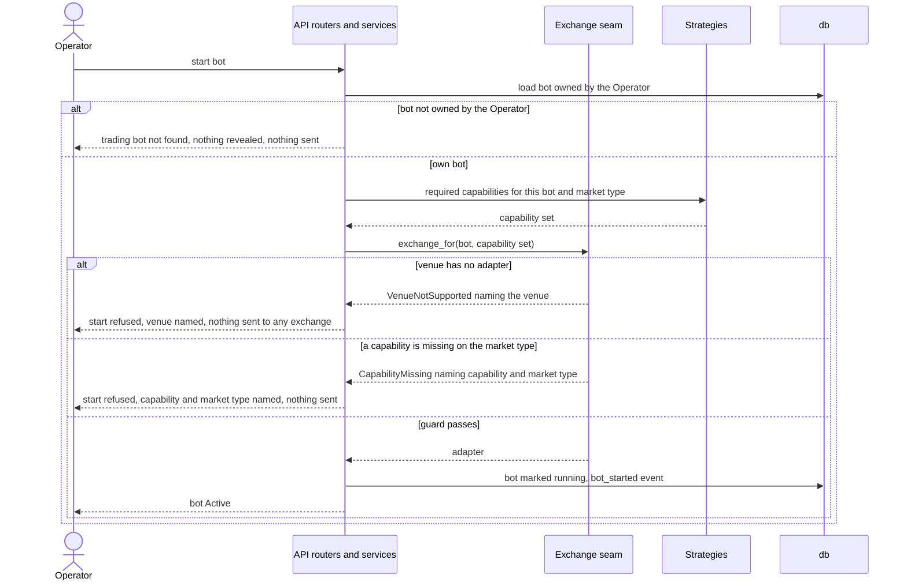

### Runtime flows per user story

The flows below cover every spec §4 user story and §5 AC (coverage table at the end of this section). They use generic participants: `service (…)` is a §5 building block (API routers and services, bot worker, strategies and runtimes, exchange seam, exchange adapter), `data-store` is the backend database, `external-system` is an exchange or the notification channel, and `message-bus` is the exchange's live event stream. Every write carries a `persists …` note for `data-model`.

### Flow 1: A bot tick trades through its venue's adapter (US-01)

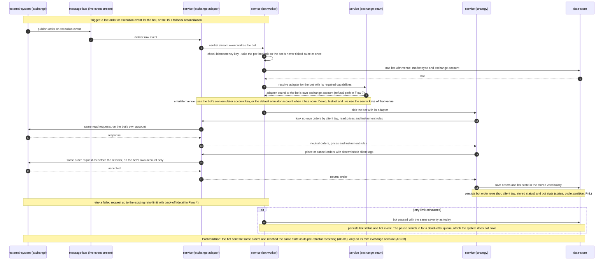

### Flow 2: The Operator reads or acts on a bot (US-01, US-04)

```mermaid
sequenceDiagram
    autonumber
    participant C as client (Operator)
    participant API as service (API)
    participant DB as data-store
    participant SEAM as service (exchange seam)
    participant AD as service (exchange adapter)
    participant EX as external-system (exchange)

    Note over C,API: Precondition: the Operator is signed in and names a bot by id
    C->>API: open the bot page, or stop, sync, cancel orders, close the position, clear history, read live position or orders
    API->>DB: load the bot owned by the Operator
    alt bot belongs to another platform user or does not exist
        DB-->>API: no bot for this owner
        API-->>C: trading bot not found, no venue or state revealed
        Note over API,EX: no guard call and nothing sent to any exchange (AC-11)
    else own bot
        DB-->>API: bot
        API->>SEAM: resolve adapter for the bot with the capabilities this action needs
        alt venue has no adapter or a capability is missing, and the action is the bot page read
            SEAM-->>API: refused, venue or capability and market type named
            API->>DB: read the stored performance figures
            DB-->>API: stored figures
            API-->>C: page with the stored figures, no refresh, nothing sent to any exchange (AC-02, AC-10)
        else venue has no adapter or a capability is missing, and the action is clear history
            SEAM-->>API: refused, venue or capability and market type named
            API->>DB: bot stopped, its local orders and events deleted
            Note over API,DB: persists bot status; deletes bot order rows and bot events
            API-->>C: history cleared, exchange cancel skipped, the scrubbed refusal reason returned (ADR-0004 amendment, AC-16)
            Note over API,EX: the Operator's way out of a guard-refused bot; nothing sent to any exchange
        else venue has no adapter or a capability is missing, any other action
            SEAM-->>API: refused, venue or capability and market type named
            API-->>C: action refused with the reason (422), bot and orders left as they are, nothing sent to any exchange
        else guard passes
            SEAM-->>API: adapter
            opt open the bot page
                API->>AD: read the bot's executions
                AD->>EX: execution history request
                EX-->>AD: executions
                AD-->>API: neutral executions with realised PnL and fee per fill
                API-->>C: PnL, fees and closed cycles, same figures as before the step (AC-02)
            end
            opt stop, sync, cancel orders, close the position or read live state
                API->>AD: cancel, close or read in platform terms
                AD->>EX: same request as before the refactor
                EX-->>AD: response
                AD-->>API: neutral result
                API->>DB: save orders, bot status and bot event
                Note over API,DB: persists bot order rows, bot status and bot event
                API-->>C: action result
            end
            opt clear history
                API->>AD: sync the bot's orders, then cancel them in platform terms
                AD->>EX: same requests as before the refactor
                alt exchange answers
                    EX-->>AD: response
                    AD-->>API: cancelled orders
                else exchange request fails
                    EX-->>AD: error
                    AD-->>API: exchange error, already scrubbed
                    Note over API,AD: only the cancel is skipped; the error text is scrubbed again into the answer (AC-16)
                end
                API->>DB: bot stopped, its local orders and events deleted
                Note over API,DB: persists bot status; deletes bot order rows and bot events
                API-->>C: history cleared, with the cancelled count or the scrubbed cancel error
            end
        end
    end
    Note over C,DB: Postcondition: only the owner's bot ever reaches an adapter, and performance figures come from the same exchange execution history
```

### Flow 3: A mid-cycle bot resumes after a deploy (US-02)

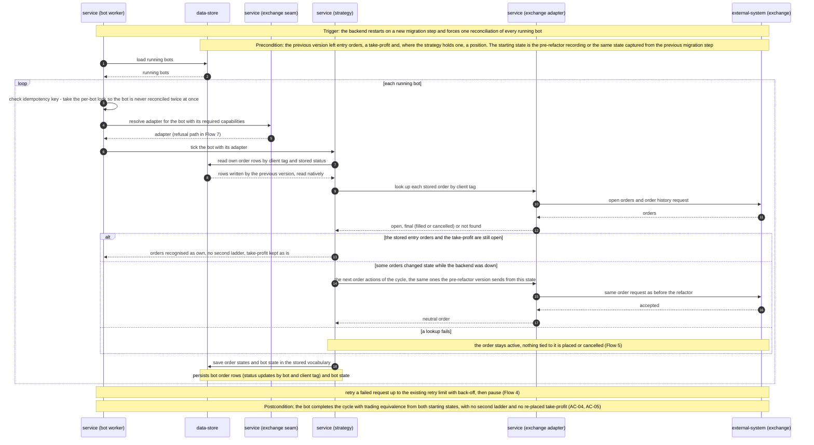

### Flow 4: An exchange failure becomes an error class and today's reaction (US-03)

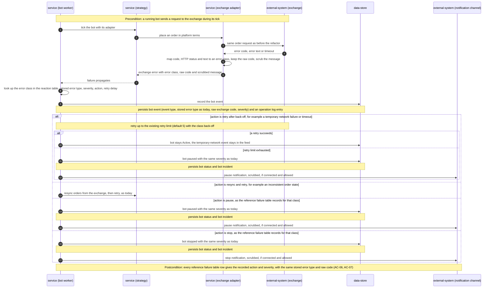

### Flow 5: An order lookup never treats a failure as proof the order is gone (US-03)

```mermaid
sequenceDiagram
    autonumber
    participant WK as service (bot worker)
    participant ST as service (strategy)
    participant AD as service (exchange adapter)
    participant EX as external-system (exchange)
    participant DB as data-store

    Note over ST,DB: Precondition: the bot has an order row it believes is active
    ST->>AD: look up the order by client tag
    AD->>EX: search open orders, then order history, by client tag
    alt order is in open orders
        EX-->>AD: open order
        AD-->>ST: open
        ST->>DB: order stays active
    else order is in order history
        EX-->>AD: history entry
        AD-->>ST: final, with its state (filled or cancelled)
        ST->>DB: order takes its final state from history
        Note over ST,DB: persists bot order row status by bot and client tag
    else exchange answers with the unknown-order error class, or the order is in neither
        EX-->>AD: unknown order, or empty in both
        AD-->>ST: not found
        ST->>DB: order marked gone
        Note over ST,DB: persists bot order row status by bot and client tag
    else lookup fails with a class the bot already retries (rate limited, network, exchange unavailable, time sync, order-state conflict, duplicate client tag)
        EX-->>AD: error code, error text or timeout
        AD-->>ST: exchange error, retryable class
        ST->>ST: keep the order active, place and cancel nothing tied to it
        ST-->>WK: lookup failed, ask again later
        Note over WK,EX: ask again on later ticks up to the existing retry limit (default 5)
        alt limit exhausted with no answer
            WK->>DB: bot paused as today
            Note over WK,DB: persists bot status and bot event
        end
    else lookup fails with any other class (rejected credentials, denied permission, invalid symbol, unclassified, …)
        EX-->>AD: error code or error text
        AD-->>ST: exchange error, non-retryable class
        ST->>ST: keep the order active, place and cancel nothing tied to it
        ST-->>WK: lookup failed with that class
        WK->>DB: that class's AC-06 reaction at once (credentials, permission or unclassified stop; invalid symbol pauses)
        Note over WK,DB: persists bot status and bot event; the order row stays active
    end
    Note over ST,EX: Postcondition: a failed lookup is never proof that an order is gone (AC-08, deliberate deviation)
```

### Flow 6: Starting a bot passes ownership, then the guard (US-04, US-06)

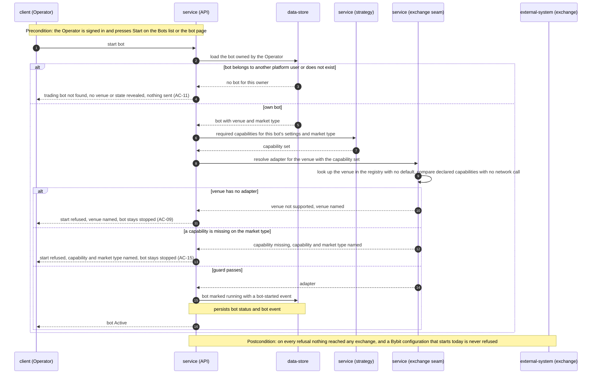

### Flow 7: A running bot whose venue lost its adapter or capability is paused (US-04, US-06)

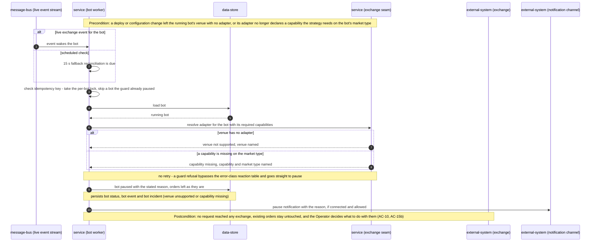

### Flow 8: The Operator checks a venue's connection (US-05)

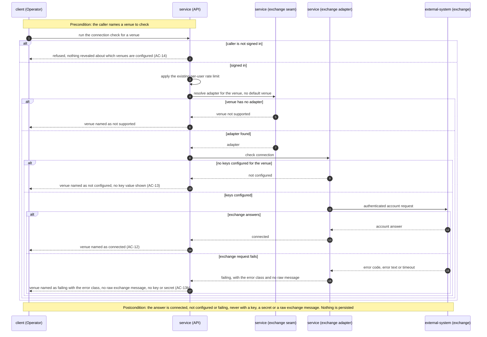

### Flow 9: Keys and secrets are scrubbed at the adapter and at every sink (US-07)

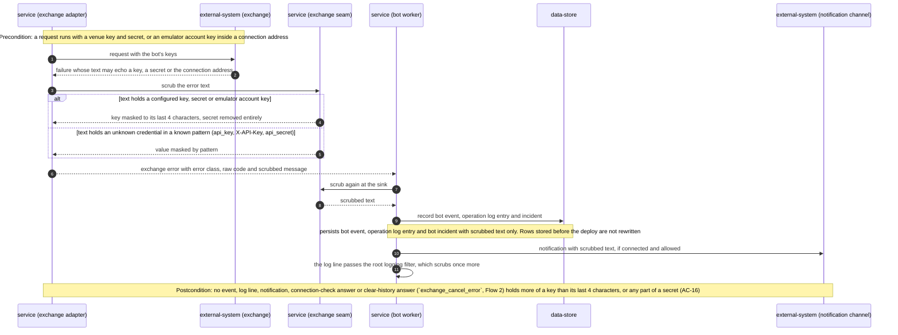

### Flow 10: A stand-in adapter plugs in with no strategy change (US-08)

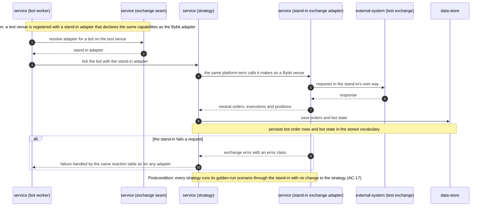

### Coverage: user stories and acceptance criteria

| User story | Realised by |
|---|---|
| US-01 Keep Bybit bots trading unchanged | Flow 1, Flow 2 |
| US-02 Running bots survive each deploy | Flow 3 |
| US-03 Same reaction to exchange failures | Flow 4, Flow 5 |
| US-04 Unsupported venue fails closed | Flow 6, Flow 7, Flow 2 (cross-user, guard-refusal and clear-history branches) |
| US-05 Check the connection of a venue | Flow 8 |
| US-06 Incompatible setting is blocked by capability | Flow 6, Flow 7 |
| US-07 Keys never leak through the adapter | Flow 9 |
| US-08 New exchange plugs in without strategy changes | Flow 10 |

| AC | Shown by |
|---|---|
| AC-01 | Flow 1, happy path and postcondition. Equivalence itself is proven by the golden-run harness (ADR-0007) |
| AC-02 | Flow 2, «open the bot page» branch |
| AC-03 | Flow 1, adapter bound to the bot's own exchange account (note after step 9) |
| AC-04 | Flow 3, precondition (both starting states) and postcondition |
| AC-05 | Flow 3, «still open» branch: orders recognised, no second ladder, take-profit kept |
| AC-06 | Flow 4, reaction-table branches (retry, resync, pause, stop) |
| AC-07 | Flow 4, «retry after back-off» branch with its success and retry-limit-exhausted sub-branches |
| AC-08 | Flow 5, all five branches. Also referenced from Flow 3 |
| AC-09 | Flow 6, «venue has no adapter» branch |
| AC-10 | Flow 7, «venue has no adapter» branch |
| AC-11 | Flow 6 and Flow 2, «bot belongs to another platform user» branch |
| AC-12 | Flow 8, «exchange answers» branch |
| AC-13 | Flow 8, «no keys configured» branch |
| AC-13b | Flow 8, «exchange request fails» branch |
| AC-14 | Flow 8, «caller is not signed in» branch |
| AC-15 | Flow 6, «a capability is missing» branch |
| AC-15b | Flow 7, «a capability is missing» branch |
| AC-16 | Flow 9. The scrubbed text also appears in Flow 4, Flow 8 and Flow 2's clear-history branches (`exchange_cancel_error`) |
| AC-17 | Flow 10 |

No user story or AC is uncovered, and none is non-runtime N/A. The flows agree with `ux-flows.md`: refusals at the action's screen (SCR-01 / SCR-02), pauses in the event feed with Telegram on top (SCR-03), and «Trading bot not found» for another user's bot. The `target_surfaces` value `[backend-service]` declares no UI surface, so no `ui` participant is drawn.

### Flagged for design (not decided here)

- **Async mapping.** Flows 1, 3 and 7 are event-driven. The idempotency-key step is the per-bot lock (plus deterministic client tags with a lookup before placing). The dead-letter step is the bot pause after the existing retry limit, because the system has no dead-letter queue. Confirm, or record as an ADR if this needs more than SAD §8.
- ~~**Guard refusal on the Operator's own bot for stop, sync, cancel or close (Flow 2).**~~ **Decided** by the ADR-0004 amendment (2026-10-15): the action is refused with 422 and the reason, the bot is left as it is, and the Operator's way out is clear history or delete. SAD §4 pillar 4 and §8 «Error handling» now say so.
- **Connection check for a venue with no adapter (Flow 8).** A fourth answer, «not supported», follows from ADR-0004 (no default venue) and is not in spec AC-12…AC-14. This is input for the `api` stage.
- **Seed flow 2 overlaps Flow 6.** The seed uses concrete §5 names, and Flow 6 is its generic version with persist notes. They are left side by side because this stage only adds. Remove the seed by hand if one is enough.
- **Stand-in test exchange (Flow 10).** Whether the stand-in adapter talks to the emulator or works in memory is left to `plan-tests`.
- **Data-model hints.** Every persisted entity already exists: bot order rows (looked up by bot + client tag, and `order_link_id` is already indexed), bot state, bot events, bot incidents and the operation log. Guard pauses add two `incident_type` values (`venue_unsupported`, `capability_missing`). The column is a free-text string, so no migration is needed.

## 7. Deployment view

<!-- 🎯 Why: the TOPOLOGY DevOps must know without reading the deploy charts — how many replicas,
     where the background worker lives, AT WHAT NUMBERS we scale.
     📋 Write: 2–3 sentences on topology + monitoring + concrete threshold numbers.
     📌 e.g. «500 authors → partition by quarter» (not «we'll think about scale later»).
     🎯 N/A allowed for XS/S that reuses an existing deployment unit with no change.
     Deployment-diagram scaffold → templates/deployment.md. -->

**No topology change.** The feature runs in the existing `docker compose` units: frontend, backend (FastAPI with the in-process bot worker, one process), exchange emulator and PostgreSQL 18 (`docker-compose.yml`). It adds no container, port, environment variable or volume. Bybit keys stay `BYBIT_{DEMO|TESTNET|LIVE}_API_KEY/SECRET` on the server, shared per venue (spec §3 non-goal: per-operator keys).

**Deploying a migration PR.** Each migration step is deployed while bots are running. The backend restarts, the worker loop starts in the lifespan hook and forces a reconcile (`reconcile_if_due(force=True)`, `runtime.py`), and mid-cycle bots resume on the new code. Spec AC-04 and AC-05 prove this exact path with the mid-cycle golden runs before the PR merges.

**Release (2026-10-18).** The migration steps were built and gated one by one as commits on one branch, and this release deploys them **once**, onto bots running the pre-refactor version (confirmed by the Operator, review 2026-10-18 finding 1). The deploy's real previous state is therefore the one the `mid_cycle_pre_refactor` snapshots replay (AC-04). The `mid_cycle_previous_step` replays stay as a step-to-step regression check; their snapshots were last captured at `394be42` (test-plan «Test data»). If the branch is ever split into several deploys, recapture every previous-step snapshot (`GOLDEN_CAPTURE_PREVIOUS=1`) on the tree deployed just before each one.

**Rollback.** Redeploy the previous image. Nothing in the schema, the stored vocabulary or the client tags changes (ADR-0003), so a rollback is as safe for mid-cycle bots as a forward deploy. Orders placed by the newer code are read natively by the older code.

**Monitoring:**
- **Metrics:** no metrics stack exists (no Prometheus, no tracing). Reaction latency and adapter overhead are measured by the golden-run harness before every merge (spec §6), not in production.
- **Alerts:** the existing bot incidents and operations log (`create_bot_incident`, `record_operation_log`, with `exchange` and `error_type`) plus Telegram notifications. Guard pauses get their own incident type (`venue_unsupported` / `capability_missing`) so they are not mistaken for exchange errors.
- **Tracing:** correlation id `bot:{id}` on operation-log entries, as today.

**Scaling thresholds:**
- One backend process, bots serialised per bot by asyncio locks (`runtime.py:65`). The adapter adds at most 5 ms to the p95 of a single exchange request (spec §6), so worker throughput is unchanged at today's bot counts.
- The emulator session cache (`lru_cache(maxsize=256)`, keyed by emulator account key) moves into the Bybit adapter unchanged. Above 256 distinct emulator keys, sessions are rebuilt on demand, as today.

## 8. Crosscutting concepts

<!-- 🎯 Why: CROSS-CUTTING PATTERNS spanning several modules: logging, errors, authorization, ID
     strategy, events, caching. ⭐ The second-densest section. A pattern inside one module is NOT
     here; a project-wide convention belongs in the convention file.
     📋 Write: a table — concept / convention / where defined. One row per concept.
     📌 e.g. «sortable time-based IDs generated in the app layer» as a default from the convention file. -->

| Concept | Convention | Where defined |
|---|---|---|
| Logging | Stdlib logging (`app.core.logging`). A root logging filter applies the shared scrubber, so no key or secret reaches a log line (ADR-0008) | `BE/app/core/logging.py`; `bot_engine/exchange/redaction.py` |
| Secrets | One scrubber knows every configured key and secret of every venue plus the emulator account keys in use. It is applied by the adapter to every `ExchangeError` and again by every sink (`log_bot_event` → Telegram, `record_operation_log`, `create_bot_incident`, the connection check, the clear-history `exchange_cancel_error`). Keys appear at most as `****abcd`, secrets never (AC-16). Records stored before the deploy are not rewritten | ADR-0008 |
| Authentication / authorization | JWT via the existing API dependencies. Bot ownership is checked by `get_trading_bot(db, bot_id, user_id)` → 404 «Trading bot not found» **before** any venue routing or guard, so another user's bot reveals no venue or state (AC-11). The connection check requires a signed-in operator (AC-14) and stays under the existing per-user in-memory rate limit (`app.core.rate_limit`) | `BE/app/api/deps.py`, `BE/app/api/bots.py` |
| Error handling | The adapter raises `ExchangeError(error_class, raw_code, scrubbed message)`. The engine maps error class → (stored error type, severity, action, retry delay) with today's values. Non-exchange failures (configuration, internal) are classified as today. Guard refusals (`VenueNotSupported`, `CapabilityMissing`) are a separate path: a refused start at the API, a pause with the reason while running, or a 422 with the reason on any other action (the bot page read degrades to stored figures; clear history skips only the exchange cancel), never retried | ADR-0004, ADR-0005; `bot_engine/error_handling.py` |
| Order lookup (AC-08) | The adapter's `lookup_order(tag)` answers `open`, `final(filled / cancelled / …)` or `not_found`, searching the exchange's open orders and order history **by client tag** (not today's «last 50 history items», `orders.py:39-50`). If a lookup fails with any class other than `unknown_order`, the order stays active and nothing tied to it is placed or cancelled. A class the bot already retries (rate limited, network, exchange unavailable, time sync, order-state conflict, duplicate client tag) asks again up to the existing `error_max_retries` (default 5), then pauses as today; any other class takes its AC-06 reaction at once (credentials, permission or unclassified stop; invalid symbol pauses), per the AC-08 clarification. An order is gone only on `unknown_order` or `not_found`, and a `final` answer gives its final state. This is the deliberate AC-08 deviation, introduced in one migration step and recorded as such in the reference failure table | `bot_engine/exchange/port.py`; ADR-0005 |
| ID strategy | Integer autoincrement PKs. Client order tags stay `bot-{id}-g{generation}-…` plus today's deterministic suffixes. The maximum tag length is a declared capability value (Bybit: 36) | ADR-0003, ADR-0006 |
| Numbers | Prices, quantities, fees and PnL stay floats converted exactly as today. Rounding stays `round_to_step` (Decimal internally) over neutral `InstrumentRules` (`qty_step`, `tick_size`, `min_order_qty`, `min_notional_value`). No move to Decimal in this step (it would change AC-02 figures). Exception: where the exchange's text reached the page unchanged, the port carries it as a `Decimal` built from that text, so the strings stay the same: ticker and position prices (T31). Execution qty, price, fee and realised P&L are Decimals from the exchange text too, as performance read them before the adapter (T33) | `bot_engine/orders.py:53-98` |
| Time | `app.core.clock.utcnow` everywhere. The golden-run harness pins the simulated clock for replays and uses the wall clock for latency (spec §6) | `BE/app/core/clock.py`; ADR-0007 |
| Events | `log_bot_event` with today's event types and stored error types. The only new categories are the guard pause reasons (venue has no adapter, capability missing on market type), which never fire for a Bybit bot that runs today | `bot_engine/events.py` |
| Concurrency | Per-bot asyncio lock in the worker (`runtime.py:65`), unchanged. Adapter calls are synchronous and run where today's session calls run | `bot_engine/runtime.py` |
| Internationalisation | Backend messages stay English, as today. Refusal and pause reasons are shown by the existing UI states (`ux-flows.md`) | — |

## 9. Architecture decisions

<!-- 🎯 Why: the REVERSE INDEX onto the adr/ folder. `ls adr/` gives the files; §9 gives the
     semantics — why they exist, which SAD section they attach to, what status.
     📋 Write: a 4-column table, one row per ADR. Mixed status is fine.
     📌 e.g. «0001 | Store content as a table of typed blocks | Accepted | §4». -->

| # | Title | Status | Section |
|---|---|---|---|
| [0001](adr/0001-define-a-typed-exchange-neutral-adapter-port.md) | Define a typed exchange-neutral adapter port | Accepted | §4 |
| [0002](adr/0002-implement-the-bybit-adapter-over-the-existing-clients.md) | Implement the Bybit adapter over the existing pybit and emulator clients | Accepted | §4 |
| [0003](adr/0003-keep-stored-order-and-error-vocabulary-as-platform-vocabulary.md) | Keep the stored order and error vocabulary as the platform vocabulary | Accepted | §4 |
| [0004](adr/0004-resolve-adapters-by-venue-through-a-fail-closed-guard.md) | Resolve adapters by venue through one fail-closed guard | Accepted | §4 |
| [0005](adr/0005-classify-errors-in-the-adapter-and-react-in-the-engine.md) | Classify errors in the adapter and decide reactions in the engine | Accepted | §4 |
| [0006](adr/0006-declare-capabilities-statically-per-market-type.md) | Declare capabilities statically per adapter and market type | Accepted | §4 |
| [0007](adr/0007-record-golden-runs-at-the-emulator-client-in-a-pytest-harness.md) | Record golden runs at the emulator client in a pytest harness | Accepted | §4 |
| [0008](adr/0008-scrub-secrets-at-the-adapter-and-at-every-sink.md) | Scrub secrets at the adapter and again at every sink | Accepted | §4 |
| [0009](adr/0009-scope-the-static-search-to-the-exchange-trading-dialect.md) | Scope the static search to the exchange trading dialect, not the emulator admin plane | Accepted | §10 |
| [0010](adr/0010-extend-the-fastapi-error-body-and-keep-the-unversioned-api-prefix.md) | Extend FastAPI's `{detail}` error body with `code` and `details`, and keep the unversioned `/api` prefix | Accepted | §8 (api stage) |

ADR files live under `docs/features/exchange-adapter/adr/NNNN-<title>.md`.

## 10. Quality requirements

<!-- 🎯 Why: the QUALITY TREE — take a goal from §1 and break it into concrete leaves: tests,
     metrics, configs, drills. ⭐ Without §10, §1 is a manifesto. With §10 each declaration maps
     to something PROVABLE.
     📋 Write: per §1 goal — When / Then / How-verify. Numbers from spec §6 NFR VERBATIM (don't
     round ≤250ms to ≤300ms — that's a critic F6 hit).
     📌 e.g. «p95 ≤ 500 ms on a block update, verified by a 100 req/s load test». -->

Each top-3 goal from §1 is expanded into a full scenario. QG-4 is the performance guard-rail. Numbers are quoted verbatim from spec §6. Every check runs as the local pre-merge routine (SAD §2).

**QG-1. Trading equivalence across every migration step**
- **When:** any migration PR is ready to merge, including a deploy onto bots that are mid-cycle under the previous version (for this release, the single deploy onto pre-refactor, §7 «Release (2026-10-18)»).
- **Then:**
  - «100% of golden-run replays equivalent after every migration PR: 8 recordings (4 strategies × {fresh, mid-cycle}), replayed as 12 (each mid-cycle recording from both starting states of AC-04)».
  - «0 duplicate orders and 0 unintended cancellations across the mid-cycle golden runs».
  - «100% of reference failure table rows (one per error type distinguished today, plus the retry-limit-exhausted row, as defined in AC-06) produce the recorded action and severity (the failed-order-lookup row carries the AC-08 deviation as its expected reaction)».
  - «100% of existing backend and emulator tests pass on every migration PR», with only mechanical test edits.
- **How verify:**
  - The golden-run suite (ADR-0007) diffs canonicalised records: order-mutating requests only (side, rounded price and quantity, client tag, place and cancel sequence), final bot state, and event categories (event type + stored error type + raw code). Read requests (order lookups, tickers, balances, positions, executions) are recorded for diagnosis but not compared, as the glossary's «trading equivalence» covers orders, state and reactions only.
  - The failure-table check drives each reference failure through the Bybit adapter's classifier and the engine's class table.
  - `pytest` runs in `BE/` and `EXCHANGE_EMULATOR/`.
  - After release, the spec §7 KPI «refactor-caused incidents … target: 0 within 14 days after the last PR» is read from bot incidents and bot events.

**QG-2. Fail-closed safety**
- **When:** a bot whose venue has no exchange adapter, or whose strategy needs a capability its adapter does not declare for the bot's market type, is started or reaches its next check or live event. Or an exchange request fails while keys are in use.
- **Then:** the start is refused, or the running bot is paused, with the venue, or the capability and market type, named, and **no request is sent to any exchange** (AC-09, AC-10, AC-15, AC-15b). Existing orders are left untouched. No event, log, notification or connection-check answer contains a key or secret of any venue. A key appears at most as `****abcd`, and a secret never appears (AC-16).
- **How verify:**
  - Guard tests with a recording stand-in adapter assert zero requests on every refusal and pause path.
  - A registry test removes a venue or a capability and runs a mid-cycle bot to its next tick.
  - Leak tests inject the configured keys, secrets and an emulator key inside a WS URL into every error path and every sink, then assert absence.
  - API tests cover AC-12, AC-13, AC-13b and AC-14.
  - An invariant test checks that every Bybit configuration accepted today passes the guard (AC-15, last sentence).

**QG-3. Exchange extensibility**
- **When:** the last PR of this step merges, and later when the Binance adapter is added.
- **Then:** «0 places in strategies or runtimes that reach an exchange other than through an exchange adapter, at the end of the step». Every strategy trades through a stand-in adapter with no change to the strategy itself (AC-17). Spec §7 KPI: strategy files changed when the Binance adapter is added, target 0.
- **How verify:**
  - The static search (scope fixed by ADR-0009) runs over `BE/app/bot_engine/`, every backtest service (`BE/app/services/backtest_*.py`, `fast_*_backtest.py`), the connection check and the UI live stream (`BE/app/api/websockets.py`), with no exemptions. Outside `BE/app/bot_engine/exchange/` it flags any import of `pybit` or `EmulatorHTTP`, `get_bybit_session` / `get_bybit_credentials`, and any request to a `/v5/` exchange path or exchange WS endpoint. In the bot engine, the connection check and the UI stream it also flags Bybit field names (`lotSizeFilter`, `priceFilter`, `retCode`, `closedPnl`, `tradeMode`). Backtest code that parses the emulator **admin-plane** payloads (Bybit-shaped by the emulator's design) is exempt from the field-name rule only.
  - The emulator admin plane (`/api/admin/…`) is not exchange access.
  - The AC-17 stand-in-adapter golden runs.

**QG-4. Performance guard-rail**
- **When:** a golden-run replay on the emulator, compared with the pre-refactor baseline taken before the first PR.
- **Then:**
  - Reaction latency (fill → bot reaction): «p95 ≤ pre-refactor baseline + 0.5 s on the emulator (baseline measured before the first PR), measured from the moment the emulator publishes the fill event to the moment the bot sends its next order or saves its new state, whichever comes first».
  - Adapter overhead: «≤ 5 ms added to the p95 duration of a single exchange request, compared with the pre-refactor run on the same emulator».
- **How verify:** wall-clock timestamps recorded by the golden-run harness (not the simulated clock), pre-refactor vs migrated (ADR-0007).
- **Deferred, see [spec §8](./spec.md#8-open-questions) (reaction-latency NFR not yet validated):** Momentum and Pattern Scalper record 0 fill→reaction samples, and Grid and DCA ran once per side instead of 3 + 3, so this comparison cannot yet fail. The same deferral is marked in [test-plan.md](test-plan.md) «NFR validation (load)».

## 11. Risks and technical debt

<!-- 🎯 Why: ⭐ collects EVERYTHING that can break — not only the technical. Without §11 risks get
     discussed at standups and lost; debt lives only in the head of whoever accepted it.
     📋 Write: a risk/debt table — severity — mitigation — owner. Accepted debt in its own block.
     📌 The first risk is often a product risk, not a technical one. That's normal. -->

<!-- Severity literals: Low / Medium / High for regular risks; "Open question" for rows created by
     a Save-as-OQ resolution during the Socratic walk (see references/socratic.md). -->

| Risk / debt | Severity | Mitigation | Owner |
|---|---|---|---|
| Momentum and Pattern Scalper risk guards fail open when the balance or the daily result cannot be read (the daily loss stop sees zero, and sizing falls back to the maximum). Kept unchanged in this step because trading equivalence ranks above fail-closed (§1). Settles spec §8 OQ «risk guards…» | High | Accepted debt (below). Golden runs keep today's behaviour. Resolve before Binance bots run live (roadmap step 1), where balance-read failures may be more frequent, and at the latest together with the step 9 guarantees | Oleh Solomko |
| There is no CI, so the pre-merge gate (golden runs, failure table, static search, existing suites) can be skipped and a non-equivalent PR can reach the bots | Medium | One command runs the whole gate. Each PR description records its result. Spec §8 OQ «CI vs local routine» is resolved: `scripts/premerge.sh` (test-plan.md «CI placement») | Oleh Solomko |
| Strategies read Bybit keys from the stored `trading_bot_orders.raw_response` (`reduceOnly`, through `TradingBotOrder.is_reduce_only` and directly in `grid_runtime.py`). Rows written by other adapters will not carry these keys | Medium | **Deferred**, not built in this step: today's accessor reads only the Bybit key. Moving the readers to neutral keys with a legacy-key fallback is in [spec §8](./spec.md) («Bybit field names … `raw_response`»), due before the roadmap step 1 spec. Until then every stored row is written by the Bybit adapter, and the mid-cycle golden runs cover reading them (ADR-0003) | Oleh Solomko |
| The order lookup moves from «last 50 history items» (`orders.py:39-50`) to «by client tag», which changes the read requests and could mask an unintended change in what the bot then does | Medium | Introduced in a single migration step together with the AC-08 deviation. Golden runs compare only order-mutating requests, state and event categories (ADR-0007), so the read change itself is not a diff. The failed-lookup row of the reference failure table carries the AC-08 reaction | Oleh Solomko |
| The emulator has no fault injection and no partial fills (`engine.py:615`), so error-reaction equivalence rests on the reference failure table, and the `PartiallyFilled` path is never exercised by golden runs | Medium | Failure-table rows are built from real recorded Bybit error payloads, driven through the Bybit adapter's classifier and the engine's class table. Faults and partial fills arrive in roadmap step 2 | Oleh Solomko |
| A guard pause (no adapter or missing capability) could be classified as a retryable error and retried instead of pausing | Medium | Guard exceptions bypass `classify_bot_error` and take their own pause path (ADR-0004). A test asserts the bot reaches `paused` with zero exchange requests | Oleh Solomko |
| The golden-run harness runs the backend on SQLite, while production runs PostgreSQL 18, so float and JSON round-trips may differ | Low | Matches the existing test convention. One manual mid-cycle smoke run on the `docker compose` stack before the last PR of the step | Oleh Solomko |
| The backtests' instrument-info reads (`backtest_service.py:208`, `fast_momentum_backtest.py:832`, `fast_scalper_backtest.py:1010`) move to the Bybit emulator adapter (ADR-0009). Backtest results must not change (spec §3) | Low | Existing backtest tests, plus one recorded result per backtest engine compared before and after | Oleh Solomko |
| The UI live stream (`api/websockets.py:247-261`) opens `/v5/` WS connections itself with `api_key` in the URL | Medium | Migrated in step (7): it takes its stream endpoints from the adapter through the guard, and its errors pass the scrubber (ADR-0008, ADR-0009) | Oleh Solomko |
| The scrubber removes only secrets it knows. An unexpected credential (for example a new token type) inside an error text would pass | Low | Pattern masking on top of known-value masking (`api_key=…`, `X-API-Key: …`, `api_secret`). Security review of the scrubber (spec §6.1) | Oleh Solomko |
| `docs/architecture-map.md` §Conventions goes stale: exchange clients move from `bot_engine/bybit/` to `bot_engine/exchange/<name>/` | Low | Re-run `/sdd:survey` after the last PR of the step | Oleh Solomko |
| Resolved (spec §8, 2026-10-13 in [test-plan.md](test-plan.md)): which price scenarios the golden runs use, and the mid-cycle starting state for Momentum and Pattern Scalper | Low | Default accepted at `/sdd:plan-tests`. Spec default: one trend-and-range scenario per strategy plus one rounding-boundary scenario. The rounding-boundary recordings are deferred ([spec §8](./spec.md#8-open-questions), rounding-boundary golden runs): only the trend-and-range runs exist. For Momentum and Pattern Scalper, mid-cycle = an open position with its take-profit and stop orders placed | Oleh Solomko |
| Open question (spec §8): reshape Momentum and Pattern Scalper client tags longer than 36 characters now or in step 1 | Open question | Resolve before the roadmap step 1 spec. The maximum tag length is already a declared capability value (Bybit 36, ADR-0006), and tags stay unchanged in this step | Oleh Solomko |

**Accepted debt (acceptable in v1, plan to fix later):**
- **Risk guards fail open** on unreadable balance or daily result (Momentum, Pattern Scalper). Preserved for trading equivalence. To be fixed before Binance bots run live, or with step 9.
- **Bybit keeps its recovery policy:** resync and retry on inconsistent order state, with no lookup before resend and no pause on unexplained divergence. The new guarantees reach Bybit in roadmap step 9 (spec §3).
- **The stored vocabulary looks Bybit-shaped** (`New`, `Filled`…, ADR-0003). Other adapters map into it.
- **Floats, not Decimal**, for prices, quantities, fees and PnL, except where the exchange's text reaches the page or performance unchanged: ticker and position prices and execution figures are `Decimal`s built from that text (SAD §8, ADR-0001 amendment 2026-10-15).
- **Bybit's capability declarations are loose** (for example `position_reads` on spot) because they mirror today's usage. To be tightened by the strategy × market × mode matrix (decision D2).

## 12. Glossary

<!-- 🎯 Why: ⭐ the DOMAIN GLOSSARY that ends arguments a year later («checkpoint — weekly or
     biweekly? quarter — calendar or fiscal?»).
     📋 Write: a term / meaning table. Business + technical terms mixed.
     📌 e.g. «Lesson | a unit inside a course made of blocks (text, video)». -->

Terms from [project CONTEXT](../../../CONTEXT.md) and [feature CONTEXT](./CONTEXT.md) are canonical, and the definitions below are short reminders. Terms marked **(new)** were introduced by this SAD and are not yet in CONTEXT, so they are candidates for `/sdd:glossary exchange-adapter`.

| Term | Meaning |
|---|---|
| Operator | A signed-in platform user who configures, starts, stops and supervises their own bots on their own exchange accounts. Not the exchange account, and not another platform user |
| Venue | Exchange + environment a bot trades on (Bybit emulator, demo, testnet, live). Exactly one exchange adapter per venue, or a refusal. Derived from `trading_bots.exchange` + `environment` (ADR-0004). Not the market type |
| Market type | Spot, linear (USDT-M) or inverse, chosen per bot inside a venue (`trading_bots.category`). Capabilities are declared per market type |
| Exchange adapter | The one place through which bots talk to a given exchange, in platform terms (ADR-0001). Not the exchange's client library, and not the exchange emulator |
| Error class | The exchange-neutral category of a failed exchange request, which alone decides the bot's reaction. Not the raw exchange code (kept for diagnosis), and not the stored error type (ADR-0005) |
| Capability | Something an exchange adapter declares it can do on a market type, consulted instead of the exchange's name (ADR-0006, §5 catalogue). Not a strategy mode compatibility rule (D2) |
| Cycle | One round trip of a bot from its first entry order until exits bring the position back to zero. Mid-cycle = anywhere in between |
| Golden run | A reference run of one strategy on the emulator from a fixed price scenario and starting state (fresh, or mid-cycle), recorded before the refactor and reproduced after each migration step (ADR-0007) |
| Trading equivalence | Same orders, same bot state, same reaction (action + severity) to every error class. Event wording may differ, and event category + raw code must not |
| **(new)** Guard | `exchange_for(bot, needs)`: the single entry to an adapter. It refuses when the venue has no adapter or a required capability is missing, before any exchange request (ADR-0004) |
| **(new)** Stored vocabulary | The order statuses, error types and client-tag format already persisted in the database. Frozen and adopted as the platform vocabulary (ADR-0003). Distinct from error classes |
| **(new)** Reference failure table | The pre-refactor record of one real Bybit failure per error type distinguished today, plus the retry-limit-exhausted row, each with the action and severity the bot took (spec AC-06) |
| **(new)** Stand-in exchange adapter | A test adapter for a test venue that declares the same capabilities as the Bybit adapter, used to prove strategies need no change (spec AC-17) |
| **(new)** Order lookup | The adapter's by-tag answer about one order: open, final (with its state) or not found. The basis of the AC-08 rule (SAD §8) |
