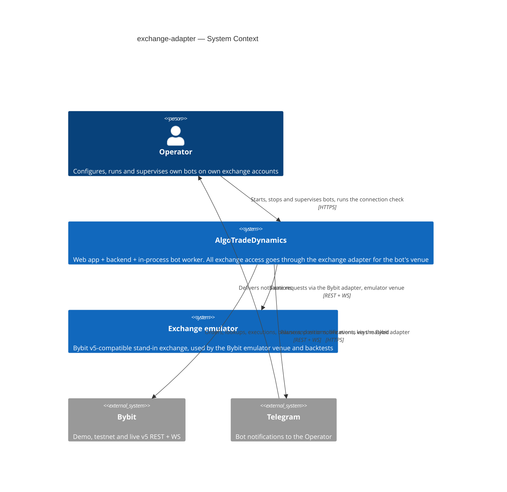
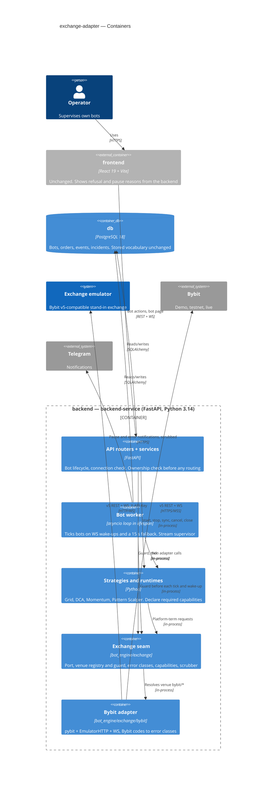
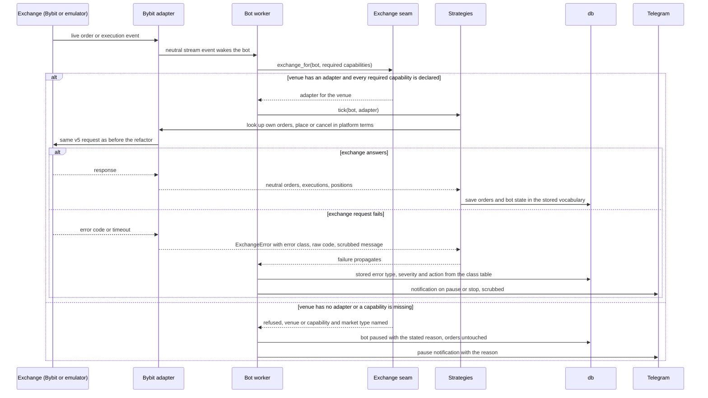
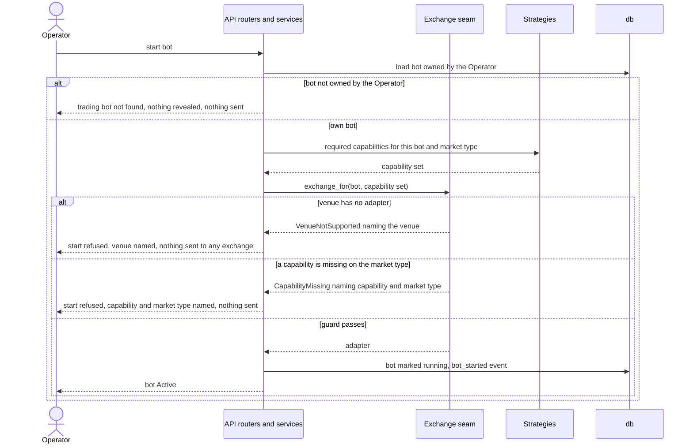

# Software Architecture Document — exchange-adapter

<!-- 12 Arc42 sections. Empty section → <!-- N/A: <one-line reason> -->. -->
<!-- C4 Context (L1) lives inline in §3. C4 Container (L2) lives inline in §5. -->
<!-- Numbers in §10 come VERBATIM from spec.md §6 NFR — no inventing, no rounding. -->

## 1. Introduction and goals

<!-- 🎯 Why: durable memory of «what + the three dominant qualities + who cares». A year from
     now nobody recalls which three qualities were critical for this system.
     📋 Write: 1 ¶ intent + 3 lines of top-3 quality goals + a stakeholders table.
     ¶4 is the override slot — critic `Override` resolutions emit «Decision override: <headline>
     — rationale: <reason>» bullets here so downstream skills see the deliberate choice. -->

**Intent.** Every Grid, DCA, Momentum and Pattern Scalper bot reaches an exchange only through one exchange-neutral **exchange adapter**, chosen by the bot's **venue**. The same goes for its runtime, the live exchange event streams, the error handling and the connection check. The adapter takes requests and returns results in platform terms, reports failures as **error classes**, and declares its **capabilities** per market type. Bybit (emulator, demo, testnet, live) moves behind it with **trading equivalence**, including bots that are mid-cycle when a migration step is deployed. An unsupported venue or a missing capability fails closed. The Operator keeps trusting their Bybit bots, and Binance (roadmap step 1) becomes "add an adapter" instead of "fork the strategies".

**Top-3 quality goals (1-liners; full scenarios in §10):**

1. **Trading equivalence across every migration step.** The same orders, bot state and error reactions as before the refactor, including mid-cycle bots across a deploy (no second ladder, no re-placed take-profit).
2. **Fail-closed safety.** No order ever reaches an exchange the bot's venue did not choose, no strategy relies on a capability its adapter did not declare, and no key or secret leaks through the adapter's error paths.
3. **Exchange extensibility.** 0 places outside exchange adapters reach an exchange, so adding an exchange changes 0 strategy files.

When goals conflict, the higher one wins (for example, keeping today's stored values beats a "purer" neutral vocabulary). Reaction latency and adapter overhead are guard-rails, not top-3 goals; their scenario is QG-4 in §10.

**Stakeholders.**

| Role | Interest | Sign-off owner? |
|---|---|---|
| Operator | Runs Bybit bots of all four strategies. Needs trading equivalence across deploys, fail-closed refusals and pauses with a stated reason, and no key leaks | No |
| Tech Lead | SAD and ADR approval, and ownership of the golden-run and failure-table gate before every merge | Yes |
| Security Lead | Exchange credentials and error payloads move into a new component (spec §6.1 «Security review: Required») | Yes |

<!-- Decision overrides (¶4) — populated by the critic resolution loop, empty otherwise. -->

## 2. Constraints

<!-- 🎯 Why: §4 strategy only works when §2 has fixed WHAT IS ALREADY FIXED — stack, versions,
     deadline, regulatory. This is an input, not an output.
     📋 Write: four blocks — Technical / Organisational / Conventions / Regulatory.
     📌 Pin versions («<datastore> 18», not «<datastore>»); «Q3 deadline — hard», not «ideally».
     Never N/A — every feature inherits at least Conventions + Technical. -->

**Technical.**
- Python 3.14 for the backend and the exchange emulator (`BE/Dockerfile`, `EXCHANGE_EMULATOR/Dockerfile`: `python:3.14-slim`).
- FastAPI 0.141.1, Uvicorn 0.52.4, SQLAlchemy 2.0.52, Alembic 1.19.1, pydantic 2.13.4, PyJWT 2.13.0, pybit 5.17.0 (Bybit SDK), websockets 17.0.1, httpx2 2.12.0 (`BE/requirements.txt`).
- PostgreSQL 18 for all backend state (`docker-compose.yml`). SQLite for `emulator.db` and for the backend test database (`BE/tests/conftest.py:9-15`).
- The bot worker is an in-process asyncio loop started in the FastAPI lifespan (`BE/app/main.py:40-42`, `BE/app/bot_engine/runtime.py`). Strategies are synchronous calls that receive a SQLAlchemy session and the bot. WS events wake the worker, REST stays the source of truth, and there is a 15 s fallback reconciliation (`runtime.py:15`).
- The exchange emulator speaks only the Bybit v5 dialect. It has no fault injection and no partial fills (`EXCHANGE_EMULATOR/app/engine.py:615`), so error-reaction equivalence is proven with the reference failure table (spec AC-06), not with emulator faults.

**Organisational.**
- Team: one developer (Oleh Solomko) acting as Tech Lead. A Security Lead review is required (spec §6.1).
- Budget: size M, about 1–2 sprints. No hard deadline. This is wave 1 of `docs/roadmap.md`, and it blocks step 1 (Connect Binance).
- There is no CI pipeline in the repo. The spec §6 checks (golden runs, failure table, static search, existing suites) run as a local pre-merge routine (spec §8 default; owner Oleh Solomko, due before `/sdd:tasks`).
- Delivery is a sequence of migration PRs. Each one must pass the golden runs, the failure table and 100% of the existing backend and emulator suites before it merges.

**Conventions.**
- [`docs/architecture-map.md`](../../architecture-map.md) §Conventions is the convention source. Exchange clients live in `BE/app/bot_engine/<exchange>/`. Routers are mounted under `/api`. Strategies are registry singletons. Errors are classified into type, severity and action (`retry_backoff`, `resync_and_retry`, `pause`, `stop`). PKs are integer autoincrement. Alembic files are named `NNNN_snake_description.py`.
- Client order tags are `bot-{id}-g{generation}-…` plus a deterministic suffix (`grid_runtime.py:41-47`, `dca_runtime.py:213`).
- Tests use pytest with an SQLite override and the emulator as the exchange double, with no SDK mocks. In this step only mechanical test edits are allowed (spec §6 «Existing test suites»).

**Regulatory / external.**
- Data classification is confidential: exchange credentials plus the Operator's balances, positions and orders (spec §6.1). No new personal data.
- Keys appear at most masked to their last 4 characters (`****abcd`). Secrets never appear, even in part. Records stored before the deploy are not rewritten (AC-16).
- The platform is multi-user. Bot ownership checks run before any venue routing (AC-11), and the connection check requires a signed-in operator (AC-14).

## 3. Context and scope

<!-- 🎯 Why: draws the SYSTEM BOUNDARY — who talks to it from outside, where the trust zone ends.
     Without §3, §5 and §8 (authorization) blur — unclear what's «inside» vs «outside».
     📋 Write: 2–3 sentences of business context + an external-systems table + a C4Context block.
     📌 «External: none (deliberate, no third-party in v1)» is itself a decision worth stating.
     Trust boundary — the line past which you don't trust data without checking it.
     Never N/A — greenfield still draws the planned actors + external systems. -->

AlgoTradeDynamics lets an Operator configure, run and supervise Grid, DCA, Momentum and Pattern Scalper bots, and run backtests of them. Today it trades only on Bybit (emulator, demo, testnet, live). This feature changes no external relationship: the same Operator talks to the same platform, and the platform talks to the same Bybit environments and the same exchange emulator. What changes is the boundary *inside* the platform. Every exchange request leaves through an exchange adapter chosen by the bot's venue, and the trust boundary around exchange responses (error texts that may echo keys, Bybit-shaped payloads) moves into that adapter.

<!-- brownfield: architecture-map.md reflects fb25db3; no BE/EXCHANGE_EMULATOR/FE change since (HEAD d75458e). direct exchange access in 9 backend files (grid_runtime, dca_runtime, momentum, pattern_scalper, orders, performance, market_data, positions, api/bybit), plus exchange_streams.py and error_handling.py. -->

**External systems (in / out):**

| Actor or system | Type | Interaction |
|---|---|---|
| Operator | Person | Signs in, creates bots, starts, stops, syncs and closes them, reads the bot page and the event feed, runs backtests and runs the connection check (API only in this step) |
| Bybit (demo / testnet / live) | System (external) | v5 REST for orders, order lookups, executions, prices, instrument rules, balances and positions, plus the v5 private and public WS streams. Keys are server-wide per environment |
| Exchange emulator | System (internal, separate deployable) | Bybit v5-compatible REST and WS. The venue «Bybit emulator» trades here with a per-bot or default emulator account key. Backtests also run here |
| Telegram | System (external) | Receives bot notifications (pauses, errors) when the Operator has connected Telegram and allows that event type |
| Binance | System (external) | **Out of scope for this step.** No adapter and no connection. Roadmap step 1 adds it behind the seam this step builds |

**C4 Context (L1):**



## 4. Solution strategy

<!-- 🎯 Why: the 3–4 STRATEGIC PILLARS every ADR grows from. Without §4 each ADR looks random —
     there's no umbrella. ⭐ The densest section — the blast-radius gate fires almost always here
     (decisions are irreversible + multi-module).
     📋 Write: 3–4 choices; each a heading + 2–3 sentences of rationale.
     📌 «Store content as a table of typed blocks» is a pillar — ADR-0001 grows from it. -->

**Target surface.** `[backend-service]`. The feature changes the backend: the API routers plus the in-process bot worker, strategies and runtimes. `ux-flows.md` shows no new screen and no new navigation. Refusal and pause reasons are backend messages, shown through the existing failed-start message, the bot page's event feed and the existing «Trading bot not found» state. The bot worker runs inside the backend process (FastAPI lifespan), so it is part of the `backend-service` container, not a separate `worker` surface. A single surface does not cross the blast-radius gate, so this is recorded inline. There is no UI-architecture decision (no UI surface).

**Top strategic choices (the seeds for ADRs):**

1. **A typed, exchange-neutral adapter port** ([ADR-0001](adr/0001-define-a-typed-exchange-neutral-adapter-port.md)). Strategies, runtimes, the stream supervisor, performance and the connection check call one `ExchangeAdapter` interface in platform terms: place, cancel and look up orders, open orders, order history, executions, instrument rules, ticker, candles, balance, positions, live event streams and the connection check. They get back neutral types and `ExchangeError` with an error class. No Bybit field name (`lotSizeFilter`, `closedPnl`, `tradeMode`, `retCode`) survives outside the Bybit adapter. This serves QG-3 (0 strategy files change for Binance), and the golden runs guard QG-1 against translation mistakes.
2. **The Bybit adapter wraps today's clients** ([ADR-0002](adr/0002-implement-the-bybit-adapter-over-the-existing-clients.md)). The adapter keeps `pybit` 5.17 for demo, testnet and live, and `EmulatorHTTP` for the emulator, as its transports. It sends the same parameters in the same order as today and only translates responses. The bytes on the wire stay identical, so trading equivalence (QG-1) is a property of the design, not of luck, and no new dependency enters the money path.
3. **The persisted vocabulary is frozen and becomes the platform vocabulary** ([ADR-0003](adr/0003-keep-stored-order-and-error-vocabulary-as-platform-vocabulary.md)). This covers stored order statuses (`New`, `PartiallyFilled`, `Filled`, `Cancelled`, `Rejected`, `Deactivated`, `Untriggered`…), stored error types (`network`, `rate_limit`, `order_state`…) and client order tags (`bot-{id}-g{gen}-…`). Rows written by the pre-refactor code are read natively by the migrated code, so a mid-cycle bot recognises its own orders after a deploy (AC-05, QG-1), and stored error types stay the same (AC-06). Any other adapter maps into this vocabulary. No data migration.
4. **Venue resolution fails closed through one guard** ([ADR-0004](adr/0004-resolve-adapters-by-venue-through-a-fail-closed-guard.md)). The venue is derived from the existing `trading_bots.exchange` and `environment` columns. A registry maps each venue to an adapter factory, with no default. One guard, `exchange_for(bot, needs)`, runs at every entry point that can reach an exchange (start, worker tick, live-event wake-up, sync, cancel, close, position and order reads) **before** any request. It either hands back the adapter or raises «venue has no adapter» or «capability missing», which the caller turns into a refused start or a pause with the reason stated (AC-09, AC-10, AC-15, AC-15b, QG-2).
5. **Error classes are decided in the adapter, reactions in the engine** ([ADR-0005](adr/0005-classify-errors-in-the-adapter-and-react-in-the-engine.md)). The adapter maps exchange codes, HTTP statuses and message texts to an error class and keeps the raw code alongside. The engine keeps one table, error class → (stored error type, severity, action, retry delay), reproducing today's reactions exactly. A new error class, `unknown_order`, is stored as today's type `order_state` and drives the AC-08 lookup rule. Raw codes never drive behaviour outside the adapter (glossary «Error class»).
6. **Capabilities are declared statically per adapter and market type** ([ADR-0006](adr/0006-declare-capabilities-statically-per-market-type.md)). Each adapter declares a constant capability set per market type (`spot`, `linear`, `inverse`). Each strategy computes the capabilities it requires from the bot's settings. The guard compares the two without any network call, so a refusal sends nothing to any exchange (AC-15). The Bybit declaration is derived from what the strategies use today, so no Bybit configuration that starts today is refused (§5 catalogue).
7. **The golden-run harness is the safety net** ([ADR-0007](adr/0007-record-golden-runs-at-the-emulator-client-in-a-pytest-harness.md)). A pytest harness runs the real exchange emulator as a local subprocess on a temporary SQLite file and the backend bot engine and worker in-process on SQLite. It drives prices through the emulator admin API and records every request at the `EmulatorHTTP` client boundary, which exists both before and after the refactor. It snapshots mid-cycle states (the emulator DB file plus the bot and order rows), and it timestamps fill → reaction on the wall clock. It produces the 8 recordings, the 12 replays and the latency and overhead numbers (spec §6).
8. **Secrets are scrubbed twice** ([ADR-0008](adr/0008-scrub-secrets-at-the-adapter-and-at-every-sink.md)). One shared scrubber knows every configured key and secret of every venue, plus the emulator account keys in use. The adapter applies it to every error it raises, and every sink applies it again: bot events, the operations log, incidents, Telegram, the connection-check answer and a root logging filter. Keys appear at most as `****abcd`, and secrets never appear (AC-16, QG-2).

**Migration order (inline; the spec commits to step by step).** (0) Build the harness, take the 8 recordings, the reference failure table and the latency and overhead baselines on the pre-refactor code. (1) Add the port, the Bybit adapter, the registry, the guard and the scrubber, with the guard wired into start and the worker tick. (2) Move the `orders.py`, `market_data.py` and `positions.py` helpers onto the port. (3) DCA (the smallest runtime). (4) Grid. (5) Momentum. (6) Pattern Scalper. (7) `performance.py`, `exchange_streams.py` and `error_handling.py`. (8) The connection check, then delete `get_bybit_session`, with the static search at 0. Every step is its own PR and passes the golden runs, the failure table and the existing suites before it merges. While the steps are in progress, the guard already protects start and the worker tick from step (1) onward.

Each tactical decision in later sections should trace to one of these seeds. Tactical decisions that *contradict* a strategic choice are red flags — surface them in §11.

## 5. Building block view

<!-- 🎯 Why: INTERNAL DECOMPOSITION — modules, containers, datastores. The static topology: who
     may talk to whom. Without §5, §6 (the flows) has no vocabulary of participants.
     📋 Write: 1 ¶ on the style (layered / hexagonal / clean / event-driven) + a folder tree + a
     C4Container block.
     📌 Draw ONE Container per declared `target_surface` (frontmatter): a fullstack
     [backend-service, web-frontend] = a backend-API container + a web/SPA container; a
     [backend-service, mobile-app] = the API + the mobile app. The Container(web, …) line below is
     just one surface's container — swap/add per what was declared in §4. → _shared/surfaces.md
     📌 e.g. «web app, content API, media worker, datastore, object store, CDN». -->

The backend keeps its current layering (routers → services → bot engine → models; `docs/architecture-map.md` §Module inventory). This feature applies **ports and adapters at the exchange boundary only**. Inside the bot engine, a new `exchange/` package owns the port (ADR-0001), the venue registry and guard (ADR-0004), the error-class and capability vocabularies (ADR-0005, ADR-0006), the scrubber (ADR-0008) and one sub-package per exchange. Strategies, runtimes, performance, the stream supervisor, the services and the connection check depend on `exchange/` and obtain an adapter only from `exchange_for(bot, needs)`. Only `exchange/<name>/` may import an exchange client (`pybit`, `EmulatorHTTP`) or open an exchange WS connection, and that is the rule the spec §6 static search enforces. This is the existing convention «exchange client → `bot_engine/<exchange>/`», gathered under one parent so that the rule is a single path prefix.

**Internal decomposition:**

```
BE/app/bot_engine/
├── exchange/                    NEW — the exchange seam
│   ├── port.py                  ExchangeAdapter Protocol + neutral types: Order, OrderLookup
│   │                            (open | final(filled/cancelled…) | not_found), Execution, Position,
│   │                            Balance, InstrumentRules, Ticker, Candle, StreamEvent, ConnectionStatus
│   ├── errors.py                ErrorClass, ExchangeError(error_class, raw_code, message),
│   │                            VenueNotSupported, CapabilityMissing
│   ├── capabilities.py          Capability enum, CapabilitySet, client_tag_max_length
│   ├── registry.py              venue (exchange, environment) → adapter factory, no default;
│   │                            exchange_for(bot, needs) — the only way to obtain an adapter
│   ├── redaction.py             Scrubber over every configured key/secret + emulator account keys;
│   │                            mask_key() → ****abcd
│   └── bybit/                   Bybit adapter (moved from bot_engine/bybit/)
│       ├── adapter.py           BybitAdapter — pybit / EmulatorHTTP transport, response → neutral types
│       ├── client.py            session factory + get_bybit_credentials (moved, private to the package)
│       ├── emulator_client.py   EmulatorHTTP (moved)
│       ├── errors.py            Bybit codes / HTTP status / texts → ErrorClass (moved from error_handling.py)
│       ├── streams.py           Bybit + emulator WS endpoints, auth, topic → StreamEvent
│       └── capabilities.py      BYBIT_CAPABILITIES per market type
├── error_handling.py            CHANGED — ErrorClass → (stored type, severity, action, delay); guard-pause path
├── exchange_streams.py          CHANGED — supervisor exchange-neutral, asks the adapter for streams
├── orders.py, positions.py,
│   market_data.py, performance.py   CHANGED — neutral helpers over the port; rounding over InstrumentRules
├── strategies/*.py, grid_runtime.py,
│   dca_runtime.py               CHANGED — required_capabilities(bot); adapter received from the guard
├── runtime.py, bot.py           CHANGED — guard before every tick/start/action
BE/app/api/bybit.py              CHANGED → venue-parameterised connection check through the adapter, auth required
BE/tests/golden/                 NEW — harness, 8 recordings, reference failure table, latency/overhead baseline
```

**Capability catalogue (ADR-0006; closes spec §8 OQ «which capabilities…»).** These are derived from what each strategy calls today, so no Bybit configuration that starts today is refused (AC-15).

| Capability | Meaning | Required by (today's usage) | Bybit declares on |
|---|---|---|---|
| `limit_orders` | Place limit orders with a client tag | Grid, DCA, Momentum, Pattern Scalper | spot, linear, inverse |
| `market_orders` | Place market orders with a client tag | DCA (market entry), Momentum, Pattern Scalper | spot, linear, inverse |
| `reduce_only_orders` | Mark an exit as reduce-only | Grid, DCA (take-profit roles), Momentum, Pattern Scalper | spot, linear, inverse |
| `position_reads` | Report open position size, side, entry, mark, liq price, leverage, margin mode | Grid, Momentum, Pattern Scalper | spot, linear, inverse |
| `short_selling` | Open short exposure | Momentum when `position_side` ∈ {`both`, `short`}, Pattern Scalper | linear, inverse (not spot; Momentum already refuses spot + short at `momentum.py:811`) |
| `execution_pnl` | Executions carry realised PnL and fee per fill | Grid, DCA (performance), Momentum, Pattern Scalper | spot, linear, inverse |
| `wallet_balance` | Read the account's available balance | Momentum, Pattern Scalper (risk guards) | spot, linear, inverse |
| `candles` | Closed candles by interval | Momentum, Pattern Scalper | spot, linear, inverse |
| `order_lookup_by_tag` | Find an order by client tag in open orders and order history | Grid, DCA, Momentum, Pattern Scalper | spot, linear, inverse |
| `private_event_stream` | Live order, execution, position and wallet events | all (worker wake-ups) | spot, linear, inverse |
| `client_tag_max_length` (value) | Longest client tag the exchange accepts | checked against the strategy's longest tag | 36 |

The Bybit declaration **mirrors today's behaviour**, including cases that are semantically loose (for example `position_reads` on spot, which Momentum calls today). Tightening is the strategy × market × mode matrix (decision D2, spec §3 non-goal). An invariant test asserts that every configuration accepted by today's `_validate_strategy_configuration` passes the guard.

**Connection check.** The check takes a venue, requires a signed-in operator (AC-14) and stays under the existing per-user rate limit (spec §6.1). It goes through `exchange_for(venue)` and the adapter's `check_connection()`, and answers `connected`, `not_configured` or `failing` + error class, never with a raw exchange message or any key (AC-12, AC-13, AC-13b). It **replaces** today's unauthenticated, demo-only `/api/bybit/test` with a venue-parameterised route under an exchange-neutral name. The exact path and shape are decided by the `api` stage. Nothing in `FE/src` calls the old route (`ux-flows.md` §Platform decisions), so it is removed without a UI change. The existing connection-check test changes, which spec §6 allows for this test only. There is no default venue (ADR-0004).

**C4 Container (L2):**



The golden-run harness (`BE/tests/golden/`, ADR-0007) is test-only and not a runtime container. It runs the emulator in a subprocess and the bot engine in-process.

## 6. Runtime view

<!-- 🎯 Why: the RUNTIME FLOW of 1–2 critical scenarios — who talks to whom, when, in what order.
     Without §6, §5 is just boxes with no life.
     📋 Write: a Mermaid sequenceDiagram. Participants are names from §5 (don't invent new ones).
     Messages are semantic («saves a draft»), NO HTTP verbs / paths / status codes — endpoint-level
     sequences arrive at the `api` stage.
     📌 e.g. «author → web: composes draft → web → content API: save». Seed the primary flow(s) here;
     the `sequences` stage then covers every §5 AC (no cap). Never N/A for M+; XS/S keeps ≥1 happy-path flow. -->

These are seed flows that use the §5 container names. The `sequences` stage adds a flow or branch for every spec §5 AC: the mid-cycle recognition after a deploy (AC-04, AC-05), the order-lookup rule (AC-08), cross-user refusal (AC-11), the connection check (AC-12, AC-13, AC-13b, AC-14) and scrubbing (AC-16).

**Critical flow 1: a live event wakes a bot, which trades through its venue's adapter (US-01, US-03, US-04, US-06)**



**Critical flow 2: Operator starts a bot and the start is checked before anything reaches an exchange (US-04, US-06)**



## 7. Deployment view

<!-- 🎯 Why: the TOPOLOGY DevOps must know without reading the deploy charts — how many replicas,
     where the background worker lives, AT WHAT NUMBERS we scale.
     📋 Write: 2–3 sentences on topology + monitoring + concrete threshold numbers.
     📌 e.g. «500 authors → partition by quarter» (not «we'll think about scale later»).
     🎯 N/A allowed for XS/S that reuses an existing deployment unit with no change.
     Deployment-diagram scaffold → templates/deployment.md. -->

<Topology in 2–3 sentences. Where it runs, replicas, scaling thresholds.>

**Monitoring:**
- <Metrics — e.g. `<metric_name>`>
- <Alerts — e.g. «worker lag > 10 min → page on-call»>
- <Tracing — e.g. spans on the request boundary>

**Scaling thresholds:**
- <e.g. comfortable in one table up to N rows/year>
- <e.g. partition by quarter above N rows/year>

<!-- For XS/S with no deployment change: <!-- N/A: reuses existing deployment unit, no infra change --> -->

## 8. Crosscutting concepts

<!-- 🎯 Why: CROSS-CUTTING PATTERNS spanning several modules: logging, errors, authorization, ID
     strategy, events, caching. ⭐ The second-densest section. A pattern inside one module is NOT
     here; a project-wide convention belongs in the convention file.
     📋 Write: a table — concept / convention / where defined. One row per concept.
     📌 e.g. «sortable time-based IDs generated in the app layer» as a default from the convention file. -->

| Concept | Convention | Where defined |
|---|---|---|
| Logging | <e.g. structured, fields `module=<name>`> | <convention file §X or here> |
| Authentication | <e.g. token-based via middleware> | <convention file §X> |
| Error handling | <e.g. domain sentinel → ports error mapping → JSON> | <convention file §X> |
| ID strategy | <e.g. sortable time-based ID in the app layer> | <convention file §X> |
| Internationalisation | <e.g. N/A, single language> | — |
| Observability | <e.g. tracing on the request boundary> | — |
| Events | <module-specific patterns, if any> | <here> |

## 9. Architecture decisions

<!-- 🎯 Why: the REVERSE INDEX onto the adr/ folder. `ls adr/` gives the files; §9 gives the
     semantics — why they exist, which SAD section they attach to, what status.
     📋 Write: a 4-column table, one row per ADR. Mixed status is fine.
     📌 e.g. «0001 | Store content as a table of typed blocks | Accepted | §4». -->

| # | Title | Status | Section |
|---|---|---|---|
| <NNNN> | <imperative — e.g. "Use a sliding-window counter for rate limiting"> | Accepted | §<N> |
| <NNNN> | <imperative — e.g. "Co-locate the worker in the API process"> | Accepted | §<N> |

ADR files live under `docs/features/<slug>/adr/NNNN-<title>.md`.

## 10. Quality requirements

<!-- 🎯 Why: the QUALITY TREE — take a goal from §1 and break it into concrete leaves: tests,
     metrics, configs, drills. ⭐ Without §10, §1 is a manifesto. With §10 each declaration maps
     to something PROVABLE.
     📋 Write: per §1 goal — When / Then / How-verify. Numbers from spec §6 NFR VERBATIM (don't
     round ≤250ms to ≤300ms — that's a critic F6 hit).
     📌 e.g. «p95 ≤ 500 ms on a block update, verified by a 100 req/s load test». -->

Each top-3 goal from §1 expanded into a full scenario:

**QG-1. <quality attribute>**
- **When:** <trigger condition>
- **Then:** <expected behaviour with numbers from spec §6 NFR>
- **How verify:** <test / chaos drill / load test / metric>

**QG-2. <quality attribute>**
- **When:** <trigger>
- **Then:** <expected>
- **How verify:** <how>

**QG-3. <quality attribute>**
- **When:** <trigger>
- **Then:** <expected>
- **How verify:** <how>

## 11. Risks and technical debt

<!-- 🎯 Why: ⭐ collects EVERYTHING that can break — not only the technical. Without §11 risks get
     discussed at standups and lost; debt lives only in the head of whoever accepted it.
     📋 Write: a risk/debt table — severity — mitigation — owner. Accepted debt in its own block.
     📌 The first risk is often a product risk, not a technical one. That's normal. -->

<!-- Severity literals: Low / Medium / High for regular risks; "Open question" for rows created by
     a Save-as-OQ resolution during the Socratic walk (see references/socratic.md). -->

| Risk / debt | Severity | Mitigation | Owner |
|---|---|---|---|
| <e.g. Worker lag may reach hours during a downstream outage> | Medium | <alert >10 min, on-call playbook, retry backoff> | <DevOps> |
| <e.g. No event-schema versioning in v1> | Medium | <ADR-NNNN planned for v2, tolerate unknown fields> | <Backend> |
| Open architectural decision: <decision-headline> | Open question | Resolve before <stage trigger or YYYY-MM-DD>; <inline rationale from the Save-as-OQ> | <owner> |

**Accepted debt (acceptable in v1, plan to fix later):**
- <e.g. the entity is immutable / unversioned — OK for v1, may need audit versioning in v2>

## 12. Glossary

<!-- 🎯 Why: ⭐ the DOMAIN GLOSSARY that ends arguments a year later («checkpoint — weekly or
     biweekly? quarter — calendar or fiscal?»).
     📋 Write: a term / meaning table. Business + technical terms mixed.
     📌 e.g. «Lesson | a unit inside a course made of blocks (text, video)». -->

| Term | Meaning |
|---|---|
| <e.g. domain object A> | <its meaning in this domain> |
| <e.g. domain object B> | <its meaning> |
| <e.g. domain invariant name> | <the rule, in plain language> |
