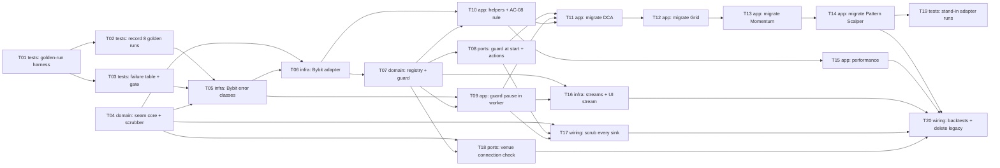

# Epic — exchange-adapter

> **Spec:** [spec.md](../spec.md) · **Design:** [sad.md](../sad.md) · **Data model:** [data-model.md](../data-model.md) (no schema change) · **API:** [openapi.yaml](../contracts/openapi.yaml) · [events.md](../contracts/events.md) · **ADRs:** [adr/](../adr/)

## Goal

Every Grid, DCA, Momentum and Pattern Scalper bot, plus its runtime, live streams, error handling and the connection check, reaches an exchange only through the exchange adapter for the bot's venue. Bybit (emulator, demo, testnet, live) moves behind it with trading equivalence at every migration step, including bots that are mid-cycle across a deploy. An unsupported venue or a missing capability fails closed: refused at start or paused while running, never routed elsewhere (spec §2 Goals).

## Scope

- **In:** `BE/app/bot_engine/` (new `exchange/` seam + Bybit adapter, guard, error-class table, scrubber; all four strategies and the Grid/DCA runtimes; performance; stream supervisor), `BE/app/api/` (bot routes behind the guard, new venue connection check, UI live stream), `BE/app/services/` (guard entry points, sinks, backtest instrument reads), `BE/tests/golden/` (harness, recordings, failure table, static search, pre-merge gate). Surface: `backend-service` only — no `ui` layer.
- **Out:** a Binance adapter and Binance emulator dialect; any change in backtest results; per-operator exchange keys; new Bybit guarantees (lookup before resend, pause on divergence); emulator faults and partial fills; new UI; the strategy × market × mode matrix (spec §3). No DB migration (`data-model.md` `schema_change: false`).

## Task map

The same DAG as [tasks.json](../tasks.json). Waves are the longest-path depth; tasks in one wave can run in parallel unless they share a lane (overlapping `files_hint`).

**Parallel branches:** wave 1 = T01 ∥ T04 · wave 2 = T02 ∥ T03 · wave 6 = T08 ∥ T09 ∥ T10 ∥ T18 · wave 7 = T11 ∥ T15 ∥ T16 ∥ T17 · wave 11 = T19 ∥ T20. **Serialized lanes:** `error_handling.py` (T05 → T09 → T17), `bot.py` (T08, T09), `trading_bot_service.py` (T08 → T17), `runtime.py` (T09 → T16), `strategies/*.py` (T07 → T11…T14), `BE/tests/golden/recordings/` (T02 → T11 → T12 → T13 → T14), `orders.py` (T10 → T20).

## Tasks

See [tracker.md](./tracker.md) for status. Machine contract: [tasks.json](../tasks.json).

| # | Task | Layer | Blocked by | DoD (short) |
|---|---|---|---|---|
| T01 | [Build the golden-run harness around the emulator client](./t01-golden-run-harness.md) | tests | — | Smoke scenario recorded twice is canonically equal |
| T02 | [Record the 8 golden runs and the latency/overhead baselines](./t02-record-golden-runs.md) | tests | T01 | 12 replays pass on unchanged code |
| T03 | [Record the reference failure table, add static search + pre-merge gate](./t03-failure-table-and-gate.md) | tests | T01 | Failure table passes; `scripts/premerge.sh` exits 0 |
| T04 | [Add the exchange seam core: port, errors, capabilities, scrubber](./t04-exchange-seam-core.md) | domain | — | Enums match contract; scrubber masks `****abcd`, drops secrets |
| T05 | [Move Bybit error classification into the adapter; engine class table](./t05-bybit-error-classes.md) | infra | T02, T03, T04 | 100% failure-table rows through two layers |
| T06 | [Build the Bybit adapter over pybit and EmulatorHTTP](./t06-bybit-adapter.md) | infra | T04, T05 | Place/cancel byte-identical; adapter contract tests pass |
| T07 | [Add the venue registry, the guard and required capabilities](./t07-venue-registry-and-guard.md) | domain | T06 | Refusals with zero network calls; today's configs pass |
| T08 | [Run the guard at start and every Operator action](./t08-guard-at-start-and-actions.md) | ports | T07 | 422 GuardRefusal; 404 before guard (AC-11) |
| T09 | [Guard before every worker tick; pause on refusal](./t09-guard-pause-in-worker.md) | app | T05, T07 | Paused + event + incident, zero requests |
| T10 | [Helpers onto the port + AC-08 lookup rule](./t10-helpers-onto-port.md) | app | T06, T07 | Four Flow 5 branches + retry exhaustion pass |
| T11 | [Migrate DCA](./t11-migrate-dca.md) | app | T08, T09, T10 | DCA golden (fresh + mid-cycle ×2) equivalent |
| T12 | [Migrate Grid](./t12-migrate-grid.md) | app | T11 | Grid golden equivalent, no second ladder |
| T13 | [Migrate Momentum](./t13-migrate-momentum.md) | app | T12 | Momentum golden equivalent; legacy reduceOnly read |
| T14 | [Migrate Pattern Scalper](./t14-migrate-pattern-scalper.md) | app | T13 | Pattern Scalper golden equivalent |
| T15 | [Build performance from neutral executions](./t15-migrate-performance.md) | app | T10 | PnL, fees, cycles identical |
| T16 | [Streams behind the adapter; neutral supervisor + UI stream](./t16-migrate-streams.md) | infra | T07, T09 | Neutral events; no emulator key leak; live event → guard pause |
| T17 | [Scrub at every sink + root logging filter](./t17-scrub-at-every-sink.md) | wiring | T04, T08, T09 | Leak tests pass for every sink |
| T18 | [Authenticated per-venue connection check](./t18-venue-connection-check.md) | ports | T04, T07 | Five outcomes + 401; old route gone |
| T19 | [Stand-in adapter golden runs](./t19-stand-in-adapter-golden-runs.md) | tests | T14 | All four strategies run unchanged on the stand-in |
| T20 | [Backtests through the adapter, delete legacy, static search 0](./t20-close-the-step.md) | wiring | T14, T15, T16, T17, T18 | Static search == 0; backtests identical; full gate green |

## Risks / Hard rules

- **Trading equivalence ranks first** (sad §1): place/cancel requests stay byte-identical (ADR-0002); stored order statuses, error types and tag format are frozen (ADR-0003); every migration PR passes golden 12/12, the failure table and 100% of existing suites before it merges (spec §6). Only mechanical test edits, except the connection-check test (AC-14).
- **Fail closed:** the guard is the only way to obtain an adapter (ADR-0004); a guard refusal is never retried (sad §11); ownership check before any routing (spec §6.1, AC-11).
- **No secrets:** scrubber at the adapter and at every sink; keys at most `****abcd`, secrets never (ADR-0008, AC-16).
- **Accepted debt kept as is:** Momentum/Pattern Scalper risk guards fail open; Bybit keeps resync-and-retry; floats not Decimal; loose Bybit capability declarations (sad §11).
- **No CI:** the gate is the local `scripts/premerge.sh` (spec §8 default; OQ «CI vs local routine» was due before this stage and is still open).
- **Open conflict before T08:** ADR-0004 says a guarded stop moves the bot to `stopped` locally; `openapi.yaml` says `422` and the bot is left as is. T08 defaults to the contract.
