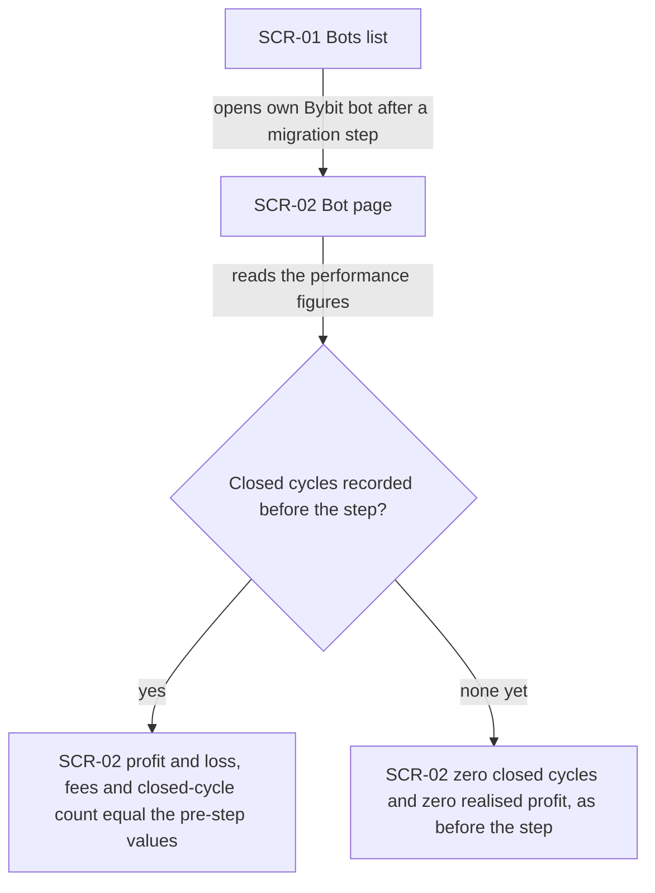
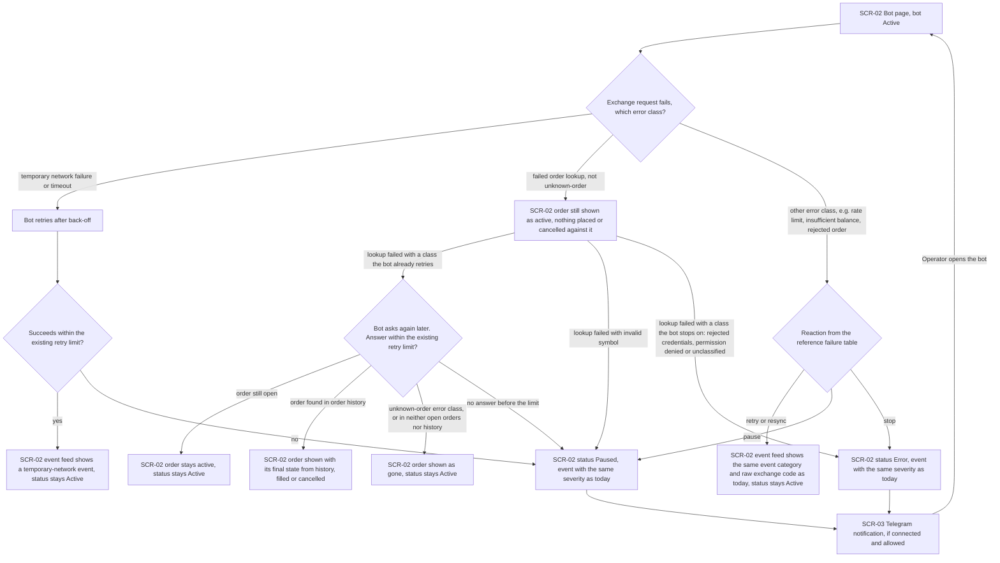
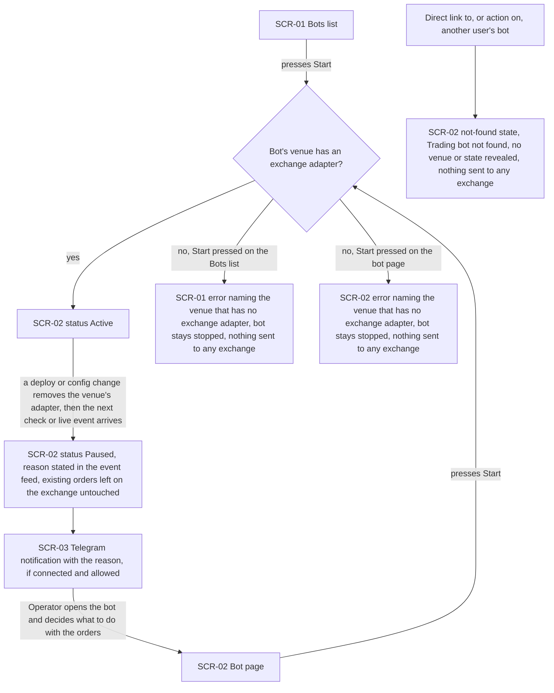
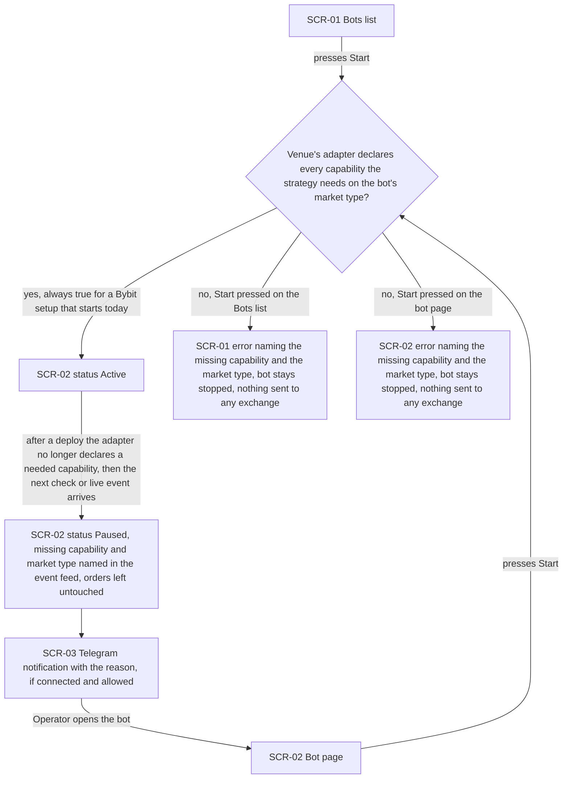
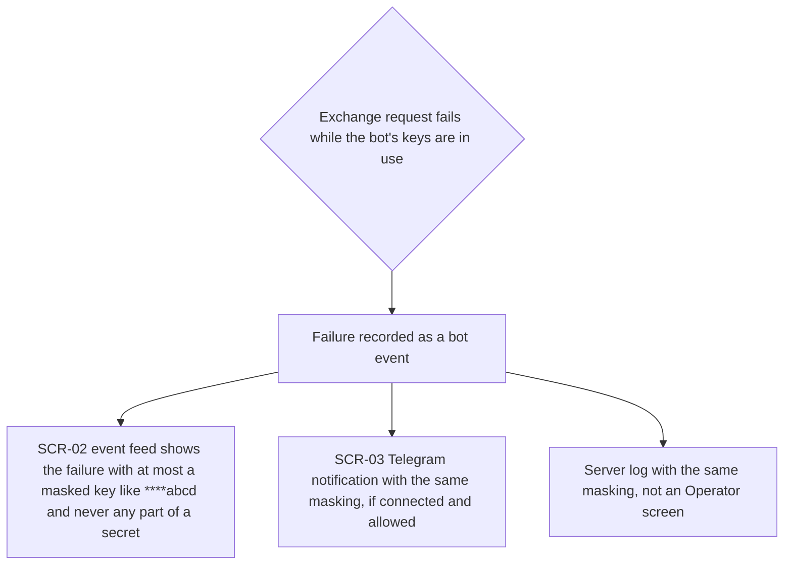

# UX flows — exchange-adapter

> User flows for every UI-touching §4 user story, produced by `ux-flows` (after `clarify`, before
> `design`) and read by `design` (evidence for the target-surface + UI-architecture decisions),
> `sequences` (UI-driven flows align on SCR ids), `screens` (details every inventory row) and
> `plan-tests` (the e2e-through-UI paths). **Always markdown + mermaid `flowchart`**, whatever the
> design tool — this artifact is flow-altitude, not visual design.

## Platform decisions

- **Posture:** desktop-first, per [`docs/design-system.md`](../../design-system.md) §Platform posture. No deviation. The feature reuses the existing pages and adds no screen (spec §3 «New UI» non-goal).
- **No new screens, no new navigation.** Every flow below runs on pages the Operator already uses; what changes is what those pages *say* (refusal reasons, pause reasons, masked keys), not where the Operator goes.
- **Refusals surface where the action was taken.** A refused start (AC-09, AC-15) is reported on the same screen the Operator pressed Start on — the Bots list or the bot page — through the error message those screens already show for a failed start. No dialog, no redirect.
- **Pauses surface on the bot page and through notifications.** A bot paused by the system (AC-07 retry exhaustion, AC-10, AC-15b) shows as Paused with its reason in the bot page's event feed — the guaranteed channel. The Telegram notification is delivered on top of it only when the Operator has connected Telegram and allows that event type, as today.
- **Another user's bot looks non-existent.** Reaching another user's bot by direct link, or any action on it, ends in the bot page's existing «Trading bot not found» state (AC-11).
- **Connection check has no screen.** No page calls the connection check today (verified: nothing in `FE/src` calls it), so US-05 is API-only in this step; per-venue status on screen arrives with roadmap step 1. The spec wording «the existing screen keeps checking only the Bybit demo venue» does not match the code — design input.

## Screen inventory

| ID | Screen | Purpose | Entry | Exit |
|---|---|---|---|---|
| SCR-01 | Bots list (`/bots`) | See own bots with their status, start and stop them | App navigation | SCR-02 (open a bot) |
| SCR-02 | Bot page (`/bots/:botId`) | One bot's status, profit and loss, fees, closed cycles, orders and event feed; start, stop, sync, cancel orders, close position | SCR-01, a direct link, or SCR-03 | SCR-01 (back) |
| SCR-03 | Telegram notification (outside the app) | Tells the Operator about a bot event while they are not looking at the app | A notifiable bot event, when Telegram is connected and the preference allows it | SCR-02 (Operator opens the bot) |

## Flows

### Flow: US-01 — Keep Bybit bots trading unchanged

The Operator opens one of their Bybit bots from the Bots list after a migration step has been deployed. If the bot had closed cycles before the step, the bot page shows exactly the same profit and loss, fees and closed-cycle count as before, because they are still built from the same exchange execution history. If it had none, it still shows zero cycles and zero profit, as before. Nothing on the page tells the Operator that a migration happened.

### Flow: US-03 — Same reaction to exchange failures

While a bot runs, an exchange request fails. **Temporary network failure or timeout:** the bot retries after a back-off. If a retry succeeds within the existing limit, the event feed shows a temporary-network event and the bot stays Active. If the failure outlasts the limit, the bot pauses with the same severity as today. **Failed order lookup** for any reason other than «unknown order» (the deliberate AC-08 deviation): the bot page keeps showing that order as active, and the bot places and cancels nothing tied to it while it asks again later. If the order turns out to be still open, nothing changes. If the order history has it, the page shows its final state from there (filled or cancelled). The order is shown as gone only when the exchange answers «unknown order», or the order is in neither the open orders nor the history. This asking again applies only to the failures the bot already retries (rate limit, network, exchange unavailable, time sync, order-state conflict, duplicate client tag): if no answer comes before the existing retry limit, the bot pauses as today. A lookup that fails for any other reason takes that failure's reaction from the reference failure table at once (rejected credentials, permission denied or an unclassified failure stop the bot and it shows as Error; an invalid symbol pauses it), and the order still stays shown as active. A failed lookup alone never removes the order from the page. **Any other error class** (rate limit, insufficient balance, rejected order, duplicate client tag, rejected credentials and so on): the bot does exactly what the reference failure table recorded. A retry or resync keeps it Active with the same event category and raw exchange code in the feed. A pause shows it as Paused, a stop as Error. Every pause or stop also goes out as a Telegram notification when the Operator has Telegram connected and allows that event, and from the notification the Operator returns to the bot page.

### Flow: US-04 — Unsupported venue fails closed

The Operator presses Start on the Bots list or on the bot page. **The venue has an exchange adapter:** the bot starts and shows Active. **It has none:** the same screen shows an error that names the venue, the bot stays stopped, and nothing reaches any exchange. **A running bot loses its adapter** after a deploy or configuration change: at the next scheduled check or live exchange event, the bot pauses, the event feed states why, its orders stay on the exchange as they are, and the Operator gets a Telegram notification if they have Telegram connected and allow that event. The Operator then opens the bot and decides what to do. **Another user's bot:** opening it by direct link, or attempting any action on it (start, stop, sync, cancel orders, close the position, read its live position or orders), ends in the bot page's existing «Trading bot not found» state. That state reveals nothing about the bot's venue or state, and nothing is sent to an exchange.

### Flow: US-06 — Incompatible setting is blocked by capability

Same shape as US-04, but the check is about capabilities rather than whether an adapter exists. The Operator presses Start on the Bots list or the bot page. **Every capability the strategy needs is declared** for the bot's market type: the bot starts. In this step that is always the case for a Bybit configuration that starts today. **A capability is missing:** the same screen shows an error naming the missing capability and the market type, the bot stays stopped, and nothing is sent. **A running bot loses a capability** after a deploy: at its next check or live event it pauses with the capability and market type named in the event feed and its orders left alone. The Operator is notified by Telegram if connected and allowed, and returns to the bot page.

### Flow: US-07 — Keys never leak through the adapter

When an exchange request fails while a bot's keys are in use, including the emulator account key inside a connection address, the failure is recorded once. Everywhere the Operator can see it, the bot page's event feed and the Telegram notification, a key appears at most masked to its last four characters (`****abcd`) and a secret never appears, not even in part. The server log follows the same rule but is not an Operator screen. Events stored before the deploy are shown as they are and are not rewritten.

### Out of scope (backend-only user stories)

- **US-02 — Running bots survive each deploy:** the Operator does nothing. The bot keeps running on the unchanged bot page (SCR-02) with no second ladder and no re-placed take-profit. This is proven by the mid-cycle golden runs (AC-04, AC-05), not by a UI path.
- **US-05 — Check the connection of a venue:** no screen calls the connection check today, so it is an API-only path in this step (AC-12, AC-13, AC-13b, AC-14 are tested at API level). Per-venue status on screen arrives with roadmap step 1.
- **US-08 — New exchange plugs in without strategy changes:** a developer-facing property, proven by the stand-in adapter golden runs (AC-17). There is no Operator interaction.

## AC coverage

| AC | Shown by | Notes |
|---|---|---|
| AC-01 | N/A: golden-run harness | Trading equivalence is proven by replay. The Operator does nothing |
| AC-02 | Flow US-01 → D / E | Bot page performance figures unchanged across the step |
| AC-03 | N/A: account isolation | Each bot trades only its own emulator account. This is backend routing with no UI path |
| AC-04 | N/A: golden-run harness | US-02 out of scope (backend-only) |
| AC-05 | N/A: golden-run harness | US-02 out of scope. The bot page simply shows one ladder, as today |
| AC-06 | Flow US-03 → H → I / F / S | Same event category and raw code in the feed. Action per the reference failure table |
| AC-07 | Flow US-03 → C → D → E / F | Temporary-network event while retrying. Paused once the retry limit is exhausted |
| AC-08 | Flow US-03 → L → M → N / O / P / F, L → F / S | Order kept shown as active, nothing tied to it placed or cancelled. Final state from history, gone only on unknown-order or absent from both, Paused at the retry limit for a retried failure, the failure's own reaction at once for any other (Paused for invalid symbol, Error for a stop) |
| AC-09 | Flow US-04 → C → E1 / E2 | Start refused on the screen where Start was pressed, venue named |
| AC-10 | Flow US-04 → D → F → G | Paused with reason. Orders left untouched. Telegram on top of the feed |
| AC-11 | Flow US-04 → X → Y | Existing «Trading bot not found» state. No venue or state revealed |
| AC-12 | N/A: API-only | US-05 out of scope. No screen calls the connection check |
| AC-13 | N/A: API-only | US-05 out of scope |
| AC-13b | N/A: API-only | US-05 out of scope |
| AC-14 | N/A: API-only | US-05 out of scope. The refusal is an API answer, not a sign-in redirect |
| AC-15 | Flow US-06 → C → E1 / E2 | Start refused naming the missing capability and the market type |
| AC-15b | Flow US-06 → D → F → G | Paused with the capability and market type named |
| AC-16 | Flow US-07 → C / D / E | Masking in the event feed and Telegram. The connection-check answer is API-only (US-05) |
| AC-17 | N/A: developer-facing | US-08 out of scope (stand-in adapter golden runs) |
