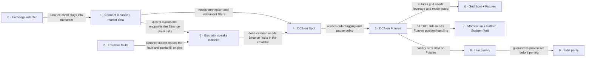

# Roadmap — AlgoTradeDynamics (Binance integration)

> **A decomposition, not a promise.** The overall idea broken into incremental steps: what each
> step is, where it comes from, how big it is — or that nobody has looked at it yet — and in which
> order, and parallel lanes, we walk them. **No dates** (except shipped history), **no scores** —
> order is the prioritization. The *solution* for any step lives in its `docs/features/<slug>/`
> spec, not here.

## Destination

The operator runs Grid, DCA, Momentum and Pattern Scalper on Binance Spot and USDT-M Futures from the existing UI, with duplicate-free orders and pause-on-divergence proven on a fault-injecting emulator, on testnet, and on a capped live canary.

## Steps

| # | Step | Source | Size | Status |
|---|---|---|:---:|---|
| 0 | Exchange adapter: strategies and runtimes reach the exchange through one exchange-neutral seam; Bybit moves behind it with no behaviour change | `architecture-map.md` §Constraints & known tech-debt | M | spec'd → [`features/exchange-adapter`](features/exchange-adapter/spec.md) |
| 1 | Connect Binance and see market data: pick Binance in the bot form, Spot testnet + Futures demo keys from env, connection status, tickers and instrument filters | `idea-brief.md` §7. Recommendation | M | idea |
| 2 | Emulator faults: partial fills, accepted-but-unanswered orders and rate-limit rejections on demand (current Bybit dialect) | `idea-brief.md` §6. Risks | M | idea |
| 3 | Emulator speaks Binance Spot + USDT-M, including the step 2 faults | `idea-brief.md` §7. Recommendation | M | idea |
| 4 | Full DCA cycle on Binance Spot: tagged orders, lookup-before-resend after timeout, pause on unexplained divergence; passes the fault checklist and a ~24h testnet soak | `idea-brief.md` §7. Recommendation | M | idea |
| 5 | DCA on Binance USDT-M Futures: One-way + Isolated guard, leverage set per bot, LONG/SHORT open-track-close | `idea-brief.md` §1. Raw idea | M | idea |
| 6 | Grid on Binance Spot + Futures as the many-orders stress test; delta-neutral grid blocked | `idea-brief.md` §7. Recommendation | M | idea |
| 7 | Momentum and Pattern Scalper on Binance → see [Not yet specified](#not-yet-specified) | `idea-brief.md` §1. Raw idea | fog | idea |
| 8 | Live canary: one DCA bot on Spot and one low-leverage DCA bot on Futures, capped capital and loss, kill switch | `idea-brief.md` §7. Recommendation | M | idea |
| 9 | Bybit parity: bring Bybit up to the same guarantees (order tagging, pause-on-divergence, fault checklist) | `idea-brief.md` §5. Out of scope | M | idea |

## Not yet specified

| Area | What we'd have to learn | Blocks | How it gets sharpened |
|---|---|:---:|---|
| Momentum and Pattern Scalper on Binance | Both parse Bybit responses directly (`retCode`, `result.list`, UNIFIED wallet, paged executions — `BE/app/bot_engine/strategies/momentum.py:114`, `pattern_scalper.py:82`); how much of that the step 0 adapter absorbs is unknown until it exists, and which of their modes are legal per market is undecided (D2) | 7 | Recon pass once step 0 ships, plus the D2 conversation |

## Out of scope

- Multi-user / third-party key handling — the operator is the only user (`idea-brief.md` §3).
- Entering API keys through the UI — keys live in env files outside Git.
- Hedge position mode and Cross margin on Futures — One-way + Isolated only; the mode is account-wide on Binance and locked while anything is open.
- More than one active bot per pair on Futures — opposite bots would net each other out in One-way mode.
- Shadow mode on live market data — it exercises none of the named order/fill/state risks.
- Going straight to full working capital — live trading starts as the capped canary (step 8).
- COIN-M Futures and other Binance products — not requested.

## Open decisions

| # | Question | Type | Owner | Blocks |
|---|---|:---:|:---:|:---:|
| D1 | Extend `EXCHANGE_EMULATOR` with a second (Binance) dialect inside the same service, or run a separate Binance emulator? | grilling | human | 3 |
| D2 | Strategy × market × mode compatibility matrix: which modes of Grid / DCA / Momentum / Pattern Scalper are allowed on Spot vs Futures, and which are blocked in UI and API? | grilling | human | 7 |
| D3 | Canary parameters: capital amount, maximum leverage, hard loss cap, and how long it runs clean before capital is raised | grilling | human | 8 |
| D4 | Use a dedicated Binance sub-account for bots, so any foreign order means a bug, not a manual trade? | grilling | human | 8 |
| D5 | The Spot testnet resets roughly monthly: does a reset during the ~24h soak restart the clock or count as an explained divergence? | grilling | human | 4 |
| D6 | Env var naming for the separate key sets (Spot testnet, Futures demo, live) — Binance issues them separately | task | agent | 1 |

## Decisions so far

- Single operator; keys in env files outside Git; UI shows only connected/masked → [`docs/idea-brief.md`](idea-brief.md) §3, §5
- Exchange state is the truth; tagged orders; pause on unexplained divergence (no auto-resync for Binance) → [`docs/idea-brief.md`](idea-brief.md) §6
- Futures restricted to One-way + Isolated → [`docs/idea-brief.md`](idea-brief.md) §5
- DCA first, Grid second as stress test → [`docs/idea-brief.md`](idea-brief.md) §7
- Stage done = scenario checklist with forced faults + ~24h clean testnet soak → [`docs/idea-brief.md`](idea-brief.md) §7
- Binance enters through an exchange adapter introduced as its own step (0), not by translating Binance into Bybit shapes → [Steps](#steps), grounded in [`docs/architecture-map.md`](architecture-map.md) §Constraints
- Canary runs right after DCA on Futures, in parallel with Grid; it validates DCA only → [Execution path](#execution-path)
- Bybit parity is a later step, after guarantees are proven live → [`docs/idea-brief.md`](idea-brief.md) §5

## Dependency graph

## Execution path

| Wave | Steps | Zone per step (why parallel-safe) | Unlocks |
|:---:|---|---|---|
| 1 | 0 ∥ 2 | 0: `BE/app/bot_engine` (strategies, runtimes, `bybit/`) · 2: `EXCHANGE_EMULATOR/app` (disjoint services) | 1, 3 |
| 2 | 1 | `BE/app/bot_engine/binance` (new) + `BE/app/schemas` + `FE/src/pages/BotsPage` | 3, 4 |
| 3 | 3 | `EXCHANGE_EMULATOR/app` | 4 |
| 4 | 4 | `BE/app/bot_engine` (`dca_runtime.py`, `error_handling.py`) | 5 |
| 5 | 5 | `BE/app/bot_engine` (positions, leverage, mode guard) | 6, 7, 8 |
| 6 | 6 ∥ 8 | 6: `BE/app/bot_engine/grid_runtime.py` · 8: `BE/app/bot_engine/runtime.py` + `BE/app/api` (kill switch, caps) — both may add options to `FE/src/pages/BotsPage`, keep those edits small | 9 |
| 7 | 9 | `BE/app/bot_engine/bybit` | — |

Step 7 enters a wave only after its recon pass.

## Shipped

| Step | Shipped | Link |
|---|---|---|
| — | — | — |
